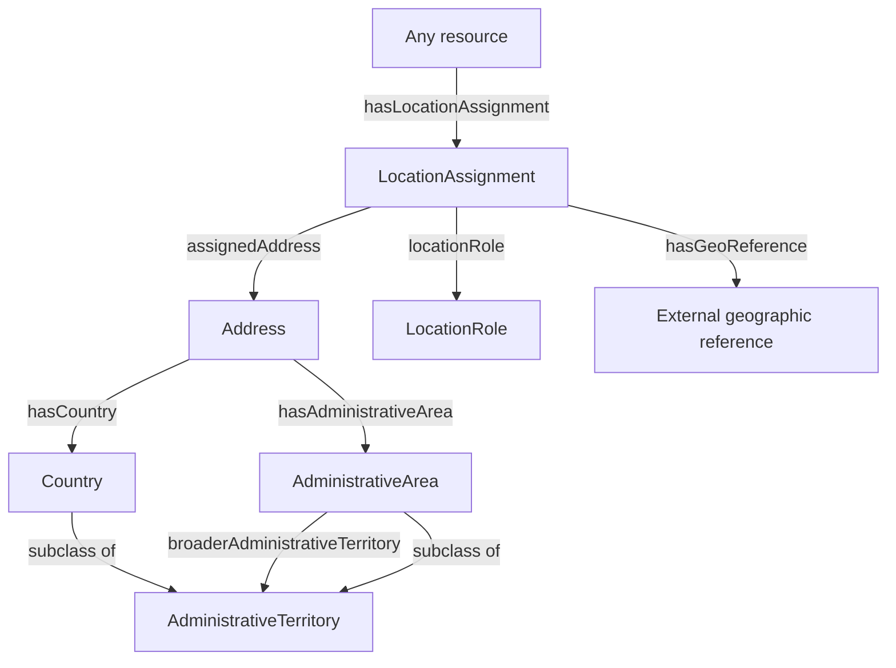

# Conceptual Model of the Construct-X Address Ontology

**Status:** Confirmed through domain review and implemented\
**Version:** 0.2.0\
**As of:** 19 November 2026\
**Scope:** `core/address`

## 1. Purpose

This document translates the results of the source analysis and subsequent domain review into the approved conceptual model for version 0.2.0. The formally defined OWL terms are provided in `ontology/conx-addr.ttl`.

The namespace is:

```text
https://www.construct-x.org/ontology/address#
```

The examples use the prefix `conx-addr:` for this namespace.

## 2. Confirmed Modeling Decisions

| Topic                    | Decision                                                                                                                                                                                |
| ------------------------ | --------------------------------------------------------------------------------------------------------------------------------------------------------------------------------------- |
| Representation           | The structured address is the authoritative data source.                                                                                                                                |
| Free-text address lines  | No ordered or unstructured address line structure is included in the core model.                                                                                                        |
| Formatted postal address | It is not intended as a primary data source and is initially not included as a property in version 0.2.0.                                                                               |
| Building details         | Building number, block, building, building part, floor, room, and internal delivery point can be represented individually.                                                              |
| Territories              | Countries and administrative units are modeled as referenceable resources rather than as simple text fields on the address.                                                             |
| Reference data           | Roles, 249 current ISO 3166-1 entries, 16 German federal states according to ISO 3166-2, and 271 Gaia-X-compatible NUTS 2 values are provided in separate A-Box reference vocabularies. |
| Address roles            | Roles are modeled through a `LocationAssignment`. New roles therefore require no changes to the core T-Box.                                                                             |
| Delivery instructions    | Department, “for the attention of,” and “c/o” are included in the core as optional properties of the location assignment.                                                                |
| Georeferencing           | The core includes the extension point `hasGeoReference`. It links a location assignment to a resource in the chosen geographic model. Geometry and coordinate systems are deferred.                                   |
| Territory identifiers    | The Address Ontology does not define its own identifier model. Territory A-Boxes use the network-wide ADMS profile with `adms:Identifier` and `skos:notation`.                          |
| Minimum requirements     | Mandatory fields for specific use cases will be defined later in SHACL profiles.                                                                                                        |
| Core validation          | General cardinalities are expressed as OWL restrictions in the T-Box and mirrored by Core SHACL Shapes as concrete data validation checks.                                              |

## 3. Model Overview



The separation is intentional: `Address` describes the structured address. `LocationAssignment` describes the address or geographic location (or both) used by a resource for a purpose. `LocationRole`, `Country`, and `AdministrativeArea` define the types of controlled reference resources whose concrete instances can be maintained outside the T-Box.

## 4. Classes

| Class | Definition | Usage |
| ----- | ---------- | ----- |
| `conx-addr:Address` | A structured collection of information describing a postal or physical address reference. | Contains only stable address components and references to territory resources. |
| `conx-addr:LocationAssignment` | A contextual assignment of an address, a geolocation, or both. | Holds the address, role, and, where applicable, recipient- or process-specific delivery instructions. |
| `conx-addr:LocationRole` | A role maintained in a controlled vocabulary that specifies the purpose of an assignment. | T-Box class; specific roles are A-Box resources, such as a delivery address or construction site address. |
| `conx-addr:AdministrativeTerritory` | A politically or administratively delimited territory. | Common superclass for countries and subordinate administrative units. It is not intended to be instantiated directly. |
| `conx-addr:Country` | A territory that is sovereign or treated as a country in the reference system used. | Referenceable country resources, such as a resource for Germany. |
| `conx-addr:AdministrativeArea` | An administrative unit below a country or another administrative unit. | Examples include a federal state, province, administrative region, district, or municipality. |

Class hierarchy:

| Subclass | Superclass |
| -------- | ---------- |
| `Country` | `AdministrativeTerritory` |
| `AdministrativeArea` | `AdministrativeTerritory` |

`LocationRole`, `Country`, and `AdministrativeArea` are not fixed, built-in lists of individuals. The T-Box defines their meaning; versioned A-Box graphs provide specific roles and territories.

## 5. Object Properties

| Property | Domain | Range | Definition | Core Cardinality |
| -------- | ------ | ----- | ---------- | ---------------- |
| `conx-addr:hasLocationAssignment` | No domain-specific restriction | `conx-addr:LocationAssignment` | Links any identifiable resource to a contextual location assignment. | 0..n |
| `conx-addr:assignedAddress` | `conx-addr:LocationAssignment` | `conx-addr:Address` | Specifies the address of a location assignment. | 0..1 |
| `conx-addr:locationRole` | `conx-addr:LocationAssignment` | `conx-addr:LocationRole` | Specifies a controlled domain-specific role of the address within this assignment. | 1..n |
| `conx-addr:hasCountry` | `conx-addr:Address` | `conx-addr:Country` | References the country of the address. | 0..1 in the core; profiles may require 1 |
| `conx-addr:hasAdministrativeArea` | `conx-addr:Address` | `conx-addr:AdministrativeArea` | References an administrative unit relevant to the address. | 0..n |
| `conx-addr:broaderAdministrativeTerritory` | `conx-addr:AdministrativeArea` | `conx-addr:AdministrativeTerritory` | Links an administrative unit to its immediate parent administrative territory or country. | 0..1 |
| `conx-addr:hasGeoReference` | `conx-addr:LocationAssignment` | Open (resource) | References the position for this use. | 0..1 |

A narrow RDFS domain is not recommended for `hasLocationAssignment`. This allows the same structure to be used for companies, people, construction sites, buildings, delivery points, or other resources without unintentionally assigning them to a new superclass through inference.

At least one of `assignedAddress` and `hasGeoReference` must be present. Both are allowed. The reference may be an IRI or a blank node. The Core leaves its RDF type open.

## 6. Address Datatype Properties

| Property | Domain | Range | Definition | Core Cardinality |
| -------- | ------ | ----- | ---------- | ---------------- |
| `conx-addr:streetName` | `conx-addr:Address` | `xsd:string` or `rdf:langString` | Name of the street, road, or comparable thoroughfare, excluding the building number. | 0..n; at most one value per language recommended |
| `conx-addr:additionalStreetName` | `conx-addr:Address` | `xsd:string` or `rdf:langString` | Additional street designation that identifies the address more precisely. | 0..n |
| `conx-addr:houseNumber` | `conx-addr:Address` | `xsd:string` | House, building, or plot number within the street. | 0..1 |
| `conx-addr:blockName` | `conx-addr:Address` | `xsd:string` or `rdf:langString` | Name of a spatial block or a comparable unit forming part of an address. | 0..n; at most one value per language recommended |
| `conx-addr:buildingName` | `conx-addr:Address` | `xsd:string` or `rdf:langString` | Proper name or commonly used designation of a building. | 0..n; at most one value per language recommended |
| `conx-addr:buildingPart` | `conx-addr:Address` | `xsd:string` or `rdf:langString` | Designation of a building part, such as a section, wing, or hall. | 0..n; at most one value per language recommended |
| `conx-addr:floor` | `conx-addr:Address` | `xsd:string` or `rdf:langString` | Designation of a floor or level within a building. | 0..n; at most one value per language recommended |
| `conx-addr:room` | `conx-addr:Address` | `xsd:string` or `rdf:langString` | Designation of a room, suite, or comparable unit. | 0..n; at most one value per language recommended |
| `conx-addr:internalDeliveryPoint` | `conx-addr:Address` | `xsd:string` or `rdf:langString` | Stable internal delivery point within a building or business premises. | 0..n; at most one value per language recommended |
| `conx-addr:postOfficeBoxNumber` | `conx-addr:Address` | `xsd:string` | Identifier of a post office box. | 0..1 |
| `conx-addr:localityName` | `conx-addr:Address` | `xsd:string` or `rdf:langString` | Name of the locality, city, municipality, or comparable settlement area. | 0..n; at most one value per language recommended |
| `conx-addr:citySubdivisionName` | `conx-addr:Address` | `xsd:string` or `rdf:langString` | Name of a subdivision of a city, locality, or municipality. | 0..n; at most one value per language recommended |
| `conx-addr:postalCode` | `conx-addr:Address` | `xsd:string` | Postal code or comparable postal area identifier. | 0..1 |
| `conx-addr:plotIdentifier` | `conx-addr:Address` | `xsd:string` | External identifier of a plot or land parcel associated with the address. | 0..n |

`xsd:string` is also used for apparently numeric components. Building numbers, postal codes, floors, rooms, and territory identifiers may contain letters, separators, or leading zeros.

A future land parcel or cadastral ontology may supplement or replace `plotIdentifier` with an object property referencing a land parcel resource. For version 0.2.0, the identifier remains a pragmatic structured component.

## 7. Location Assignment Datatype Properties

| Property | Domain | Range | Definition | Core Cardinality |
| -------- | ------ | ----- | ---------- | ---------------- |
| `conx-addr:departmentName` | `conx-addr:LocationAssignment` | `xsd:string` or `rdf:langString` | Department or organizational unit for which the address is used within this assignment. | 0..n; at most one value per language recommended |
| `conx-addr:attentionOf` | `conx-addr:LocationAssignment` | `xsd:string` | Recipient instruction meaning “for the attention of.” | 0..n |
| `conx-addr:careOf` | `conx-addr:LocationAssignment` | `xsd:string` | Recipient instruction meaning “c/o” or “care of.” | 0..1 |

These optional core properties belong to the assignment rather than to `Address`, because the same physical address can be used for different recipients, departments, and roles. Profiles can define stricter cardinalities or use-case-specific rules later.

In version 0.2.0, `attentionOf` and `careOf` remain transitional text properties. Once a suitable general model for people and organizations is available within the ontology network, complementary object properties should reference the respective actor resources. In particular, `careOf` must not be restricted to people, because an organization can also serve as a c/o recipient.

The temporal validity of an assignment is meaningful from a domain perspective, but it is not modeled through new Address properties. Instead, a consistent network-wide temporal model should be reused later.

## 8. OWL Restrictions and Core SHACL Shapes

The T-Box contains all use-case-independent cardinalities as OWL restrictions. `LocationAssignment` has at most one `assignedAddress` and one `hasGeoReference`, at least one `locationRole`, and at most one `careOf` value. `Address` has at most one value each for `hasCountry`, `houseNumber`, `postOfficeBoxNumber`, and `postalCode`. An `AdministrativeArea` has at most one direct `broaderAdministrativeTerritory`. By contrast, `plotIdentifier` deliberately allows multiple values.

The [Core SHACL Shapes](07_core-shapes.md) mirror these cardinalities and additionally check the class membership already described by domain and range, IRIs for reference resources, and literal datatypes. Because of the open-world assumption, an OWL restriction does not replace SHACL validation: missing values or multiple object values do not necessarily cause an immediate contradiction in OWL, but SHACL reports them directly in the data graph being validated.

Street, locality, postal code, and country are not universally mandatory in the core. Such minimum requirements remain the responsibility of separate application profiles.

## 9. Description of Territory Resources

Specific `Country` and `AdministrativeArea` resources receive persistent IRIs. Multilingual preferred and alternative names can be described using `skos:prefLabel` and `skos:altLabel`.

Identifiers such as ISO alpha-2, ISO alpha-3, ISO numeric, or national municipality codes require the respective identification scheme in addition to their value. This general requirement is not addressed through new Address properties. The [network-wide identifier profile](../../../../docs/architecture/identifier-model.md) uses `adms:Identifier`, the identifier value in `skos:notation`, its datatype as the identification scheme, and `adms:schemaAgency` for the issuing agency. This keeps the Address Ontology itself free of scheme-specific identifier properties.

## 10. Controlled Address Roles

The core T-Box defines only `LocationRole` and `locationRole`. Specific roles are maintained as individuals in the separate controlled vocabulary `https://www.construct-x.org/vocab/address-role`. Version `0.3.0` contains the following roles:

| Role Resource | Meaning |
| ------------- | ------- |
| `roles:DeliveryAddressRole` | Address to which goods or materials are delivered. |
| `roles:InvoiceAddressRole` | Address used for invoices. |
| `roles:PostalAddressRole` | General postal correspondence address. |
| `roles:RegistrationAddressRole` | Address recorded in a register. |
| `roles:ReturnAddressRole` | Address for return shipments. |
| `roles:ResidenceAddressRole` | Residential address of a person. The English name follows UBL `cac:ResidenceAddress`. |
| `roles:ConstructionSiteAddressRole` | General address of a construction site. |
| `roles:ConstructionSiteAccessRole` | Address or address reference for a specific construction site access point. |
| `roles:LegalAddressRole` | Legally authoritative address of a person or organization. |
| `roles:HeadquartersAddressRole` | Address of an organization's headquarters. |
| `roles:PhysicalLocationAddressRole` | Address of a resource's physical location. |

This list is explicitly not a T-Box enumeration. A new role is added as a new A-Box resource. The core ontology only needs to change if a new role requires additional structure or new general semantics. The complete bilingual definitions, notations, and UBL provenance notes are provided in the [address role vocabulary documentation](10_address-roles.md).

A `LocationAssignment` has at least one role and may have multiple roles. All other details of the assignment apply jointly to all linked roles. If, for example, the department, delivery instruction, or future validity information differs by role, separate assignments are created for the same address.

## 11. Conceptual Example Instances

The following Turtle snippets illustrate the model. An executable example instance is also provided in `examples/rub-address.ttl`. The referenced `roles:`, `countries:`, and `areas:` resources are implemented in separate reference datasets.

### Delivery Address of a Company

```turtle
@prefix conx-addr: <https://www.construct-x.org/ontology/address#> .
@prefix ex: <https://example.org/id/> .
@prefix roles: <https://www.construct-x.org/vocab/address-role#> .
@prefix areas: <https://www.construct-x.org/vocab/administrative-area/iso-3166-2-de#> .

ex:company-17
    conx-addr:hasLocationAssignment ex:company-17-delivery-address .

ex:company-17-delivery-address
    a conx-addr:LocationAssignment ;
    conx-addr:assignedAddress ex:address-4711 ;
    conx-addr:locationRole roles:DeliveryAddressRole ;
    conx-addr:departmentName "Wareneingang"@de ;
    conx-addr:attentionOf "Schichtleitung" .

ex:address-4711
    a conx-addr:Address ;
    conx-addr:streetName "Musterstraße"@de ;
    conx-addr:houseNumber "12a" ;
    conx-addr:buildingName "Logistikzentrum West"@de ;
    conx-addr:buildingPart "Halle 3"@de ;
    conx-addr:floor "Erdgeschoss"@de ;
    conx-addr:room "Warenannahme"@de ;
    conx-addr:internalDeliveryPoint "Tor 4"@de ;
    conx-addr:postalCode "44137" ;
    conx-addr:localityName "Dortmund"@de ;
    conx-addr:hasAdministrativeArea areas:DE-NW-Dortmund ;
    conx-addr:hasCountry areas:DE .
```

An application may generate a formatted postal address from this structured information. However, such a string is neither part of this example nor an alternative source for the semantic values.

### The Same Address in Multiple Roles

```turtle
ex:company-17
    conx-addr:hasLocationAssignment
        ex:company-17-general-address,
        ex:company-17-invoice-address .

ex:company-17-general-address
    a conx-addr:LocationAssignment ;
    conx-addr:assignedAddress ex:address-4711 ;
    conx-addr:locationRole roles:PostalAddressRole,
                          roles:RegistrationAddressRole .

ex:company-17-invoice-address
    a conx-addr:LocationAssignment ;
    conx-addr:assignedAddress ex:address-4711 ;
    conx-addr:locationRole roles:InvoiceAddressRole ;
    conx-addr:departmentName "Buchhaltung"@de .
```

The general assignment may have multiple roles because no other details need to differ between them. A separate assignment is used for the invoice role because `departmentName` applies only to that role. The address itself is not classified as `PostalAddress`, `RegistrationAddress`, or `InvoiceAddress`.

### Site access before a postal address exists

```turtle
ex:site conx-addr:hasLocationAssignment ex:north-gate-access .
ex:north-gate-access a conx-addr:LocationAssignment ;
    conx-addr:locationRole roles:ConstructionSiteAccessRole ;
    conx-addr:hasGeoReference ex:north-gate-position .
```

A later `assignedAddress` can be added to the same assignment. A second gate sharing that address can use its own assignment and position.

### Referenceable Territories as an A-Box

```turtle
@prefix adms: <http://www.w3.org/ns/adms#> .
@prefix areas: <https://www.construct-x.org/vocab/administrative-area/iso-3166-2-de#> .
@prefix countries: <https://www.construct-x.org/vocab/country#> .
@prefix id-scheme: <https://www.construct-x.org/vocab/identifier-scheme#> .
@prefix skos: <http://www.w3.org/2004/02/skos/core#> .

countries:DEU
    a conx-addr:Country, skos:Concept ;
    skos:prefLabel "Deutschland"@de,
                   "Germany"@en ;
    adms:identifier [
        a adms:Identifier ;
        skos:notation "DE"^^id-scheme:iso-3166-1-alpha-2
    ] .

areas:DE-NW
    a conx-addr:AdministrativeArea, skos:Concept ;
    skos:prefLabel "Land Nordrhein-Westfalen"@de ;
    conx-addr:broaderAdministrativeTerritory countries:DEU ;
    adms:identifier [
        a adms:Identifier ;
        skos:notation "DE-NW"^^id-scheme:iso-3166-2
    ] .
```

Cities are deliberately excluded from this initial territory A-Box. The structured locality name remains attached to the address through `localityName`. Background information and a complete usage example are provided in the territory reference documentation.

### Roles as an A-Box Vocabulary

```turtle
@prefix owl: <http://www.w3.org/2002/07/owl#> .
@prefix skos: <http://www.w3.org/2004/02/skos/core#> .

<https://www.construct-x.org/vocab/address-role>
    a owl:Ontology, skos:ConceptScheme ;
    owl:versionIRI <https://www.construct-x.org/vocab/address-role/0.3.0> ;
    owl:versionInfo "0.3.0" ;
    skos:prefLabel "Construct-X address roles"@en,
                   "Construct-X Adressrollen"@de .

roles:DeliveryAddressRole
    a conx-addr:LocationRole, skos:Concept ;
    skos:inScheme <https://www.construct-x.org/vocab/address-role> ;
    skos:notation "delivery" ;
    skos:prefLabel "Lieferadresse"@de,
                   "Delivery address"@en .
```

## 12. Competency Questions

Once implemented, the model should be able to answer at least the following questions:

1. Which location assignments does a particular resource have?
2. Which structured address is used in a particular assignment?
3. In which role is the address used?
4. Does the same resource use the same address in multiple roles?
5. Which department, person, or c/o recipient is associated with a particular location assignment?
6. What are the separate values for street name, building number, building, building part, floor, room, and internal delivery point?
7. In which country and administrative unit is the address located?
8. Which parent administrative units are associated with this administrative unit?
9. Which multilingual names does a referenced territory have?
10. Which position identifies the access point for this assignment?

## 13. Deliberately Excluded Concepts

The current design for version 0.2.0 does not include:

- `formattedAddress`, `addressLabel`, or a comparable formatted postal address,
- unstructured or ordered address lines as an alternative primary representation,
- dedicated properties for longitude, latitude, or altitude coordinates,
- telephone, email, fax, or opening hours as address components,
- delivery, invoice, construction site, or other role classes hard-coded into the T-Box,
- text fallbacks for countries and administrative units,
- national mandatory-field rules in the open core ontology.

Alignments with vCard, Schema.org, and UBL may later document transformation rules for unstructured source fields. This does not make such source fields semantically equivalent to properties of the structured Construct-X core.

## 14. Approval Status

All eight modeling points have been decided for version 0.2.0:

1. The six classes, including `AdministrativeTerritory`, are confirmed.
2. Each `LocationAssignment` has an address, a geolocation, or both, and one or more roles.
3. `departmentName`, `attentionOf`, and `careOf` are optional core properties.
4. `blockName`, `additionalStreetName`, and `plotIdentifier` are included in the initial T-Box.
5. `plotIdentifier` is initially represented as a literal and may later be supplemented by a link to a land parcel model.
6. The Address Ontology does not define its own identifier model; territory A-Boxes use the network-wide ADMS identifier profile.
7. `hasGeoReference` is included in version 0.2.0 with an open range.
8. The English local names are confirmed; `broaderAdministrativeTerritory` replaces the provisional name `broaderAdministrativeArea`.

T-Box version 0.2.0 implements these decisions. Roles, ISO 3166-1 countries, German ISO 3166-2 federal states, and NUTS 2 regions are available as separate, independently versioned reference vocabularies. The general identifier pattern is documented as an ADMS profile. The Gaia-X alignment remains an optional module and introduces no dependency into the core T-Box.
