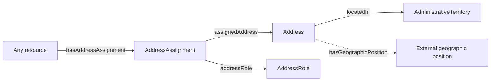

# Concept Diagram of the Address Module

**Status:** Implemented Documentation View\
**Version:** 0.1.0\
**As of:** 3 September 2026\
**Scope:** `core/address`

## 1. Core Model

## 2. Illustrative Example

> The resource may be a person or an organization. Its address assignment explains which address is referenced and what it is used for. A geographic position is optional and is described outside this module.

## 3. Further Details

The complete domain model is provided in the conceptual model.