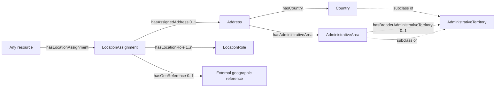

# Concept Diagram of the Address Module

**Status:** Implemented Documentation View\
**Version:** 0.3.0\
**As of:** 26 November 2026\
**Scope:** `core/address`

## 1. Core Model

## 2. Illustrative Example

> Each assignment includes an address, a geolocation, or both. Two gates may share a street address and use separate assignments to identify their respective access points.

## 3. Further Details

The complete domain model is provided in the conceptual model.
