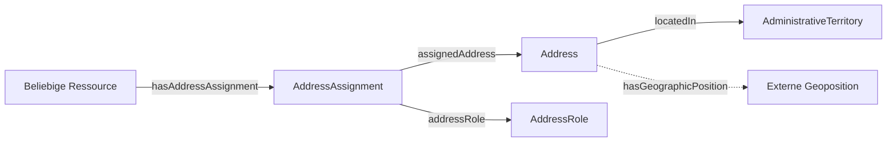

# Konzeptdiagramm des Address-Moduls

**Status:** Implementierte Dokumentationssicht  
**Version:** 0.1.0  
**Stand:** 3. September 2026  
**Geltungsbereich:** `core/address`

## 1. Kernmodell

## 2. Lesebeispiel

> Die Ressource kann eine Person oder Organisation sein. Ihre
> Adresszuordnung erklärt, welche Adresse gemeint ist und wofür sie verwendet
> wird. Eine Geoposition ist optional und wird außerhalb dieses Moduls
> beschrieben.

## 3. Vertiefung

Das vollständige fachliche Modell steht im [Konzeptmodell](../concept-model.md).
