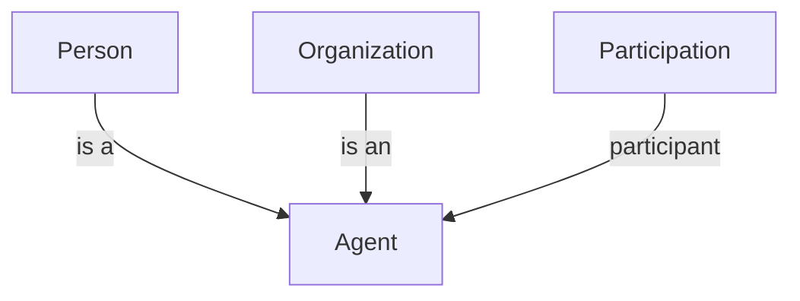

# Concept Diagram of the Agent Module

**Status:** Implemented Documentation View  
**Version:** 0.1.0  
**As of:** 3 September 2026  
**Scope:** `core/agent`

## 1. Core Model

## 2. Illustrative Example

> A Participation references an Agent. The specific Agent may be a person or an organization.

## 3. Further Details

The detailed integration diagram is available in [agent-integration-model.md](diagrams/agent-integration-model.md).
