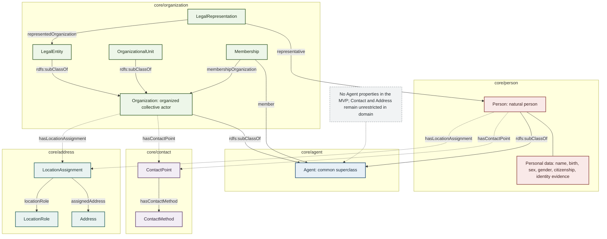

# Agent Integration Model

**Status:** Documentation view of the implemented network version 0.1.0  
**As of:** 27 August 2026

This diagram does not describe any additional OWL axioms. It shows how `conx-agent:Agent` is currently used as a minimal superclass and which domain-specific relationships remain in other modules.

## How to Read the Diagram

1. `Agent` is only the common superclass, not a master data container.
2. `Person` and `Organization` are the currently implemented local specializations of Agent.
3. `hasContactPoint` belongs to `core/contact` and remains without a restrictive `rdfs:domain`.
4. `hasLocationAssignment` belongs to `core/address` and remains without a restrictive `rdfs:domain`.
5. `Membership` and `LegalRepresentation` belong to `core/organization` because they describe organizational relationships.