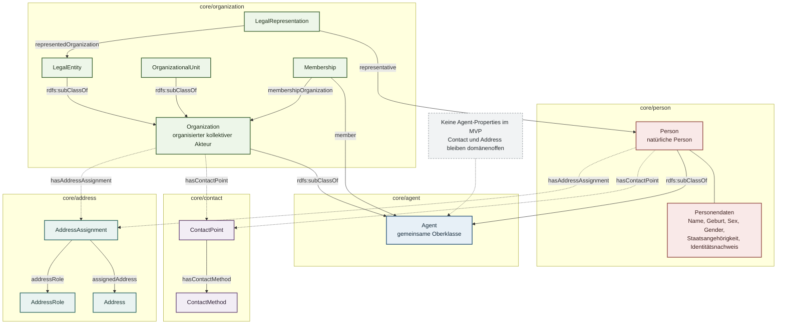

# Agent-Integrationsmodell

**Status:** Dokumentationssicht auf den implementierten Netzwerkstand 0.1.0  
**Stand:** 27. August 2026

Dieses Diagramm beschreibt keine zusätzlichen OWL-Axiome. Es zeigt, wie
`conx-agent:Agent` aktuell als minimale Oberklasse verwendet wird und welche
fachlichen Beziehungen in anderen Modulen bleiben.

## Leseregeln

1. `Agent` ist nur die gemeinsame Oberklasse, kein Stammdatencontainer.
2. `Person` und `Organization` sind die derzeit implementierten lokalen
   Agent-Spezialisierungen.
3. `hasContactPoint` gehört zu `core/contact` und bleibt ohne harte
   `rdfs:domain`.
4. `hasAddressAssignment` gehört zu `core/address` und bleibt ohne harte
   `rdfs:domain`.
5. `Membership` und `LegalRepresentation` gehören zu `core/organization`, weil
   sie Organisationsbeziehungen beschreiben.
