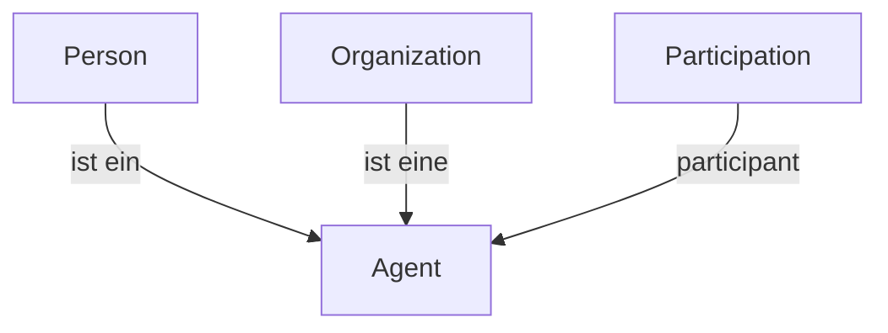

# Konzeptdiagramm des Agent-Moduls

**Status:** Implementierte Dokumentationssicht  
**Version:** 0.1.0  
**Stand:** 3. September 2026  
**Geltungsbereich:** `core/agent`

## 1. Kernmodell

## 2. Lesebeispiel

> Eine Participation verweist auf einen Agenten. Der konkrete Agent kann eine
> Person oder Organisation sein.

## 3. Vertiefung

Das ausführliche Integrationsdiagramm steht unter
[agent-integration-model.md](agent-integration-model.md).
