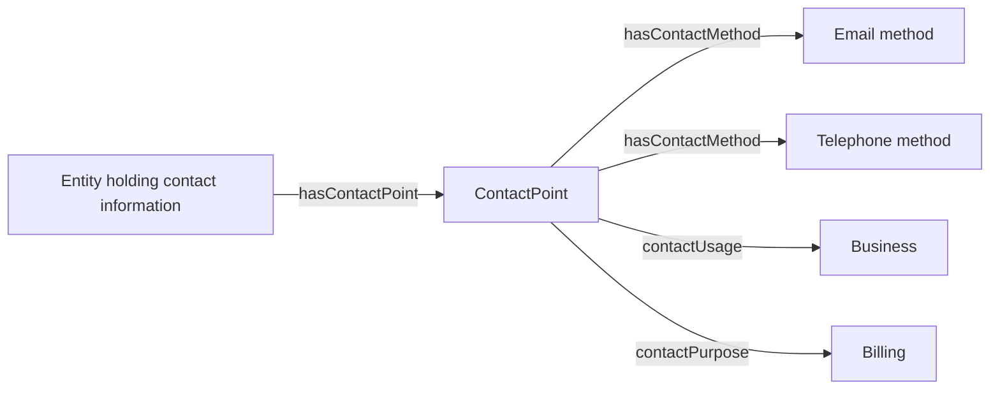

# Concept Diagram of the Contact Module

**Status:** Implemented Documentation View  
**Version:** 0.1.0  
**As of:** 3 September 2026  
**Scope:** `core/contact`

## 1. Core Model

## 2. Illustrative Example

> The contact point describes the purpose and context in which someone can be reached. The two methods contain the actual email address and telephone number.

## 3. Further Details

Additional views are provided in the [Detailed Contact Concept Diagram](diagrams/contact-concept-model.md).
