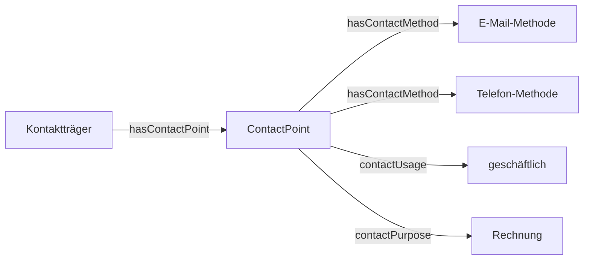

# Konzeptdiagramm des Contact-Moduls

**Status:** Implementierte Dokumentationssicht  
**Version:** 0.1.0  
**Stand:** 3. September 2026  
**Geltungsbereich:** `core/contact`

## 1. Kernmodell

## 2. Lesebeispiel

> Der Kontaktpunkt beschreibt, wofür und in welchem Kontext jemand erreichbar
> ist. Die beiden Methoden enthalten die tatsächliche E-Mail-Adresse und
> Telefonnummer.

## 3. Vertiefung

Weitere Sichten enthält das
[ausführliche Kontakt-Konzeptdiagramm](contact-concept-model.md).
