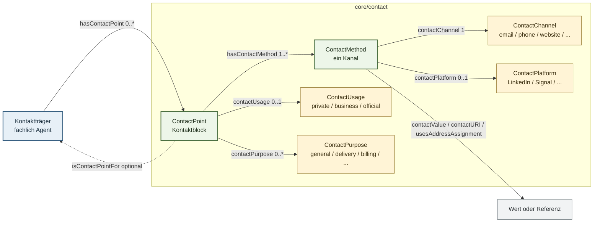
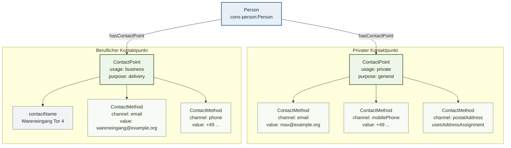
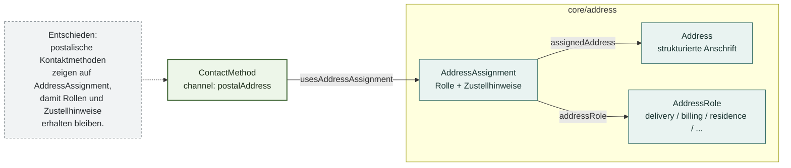
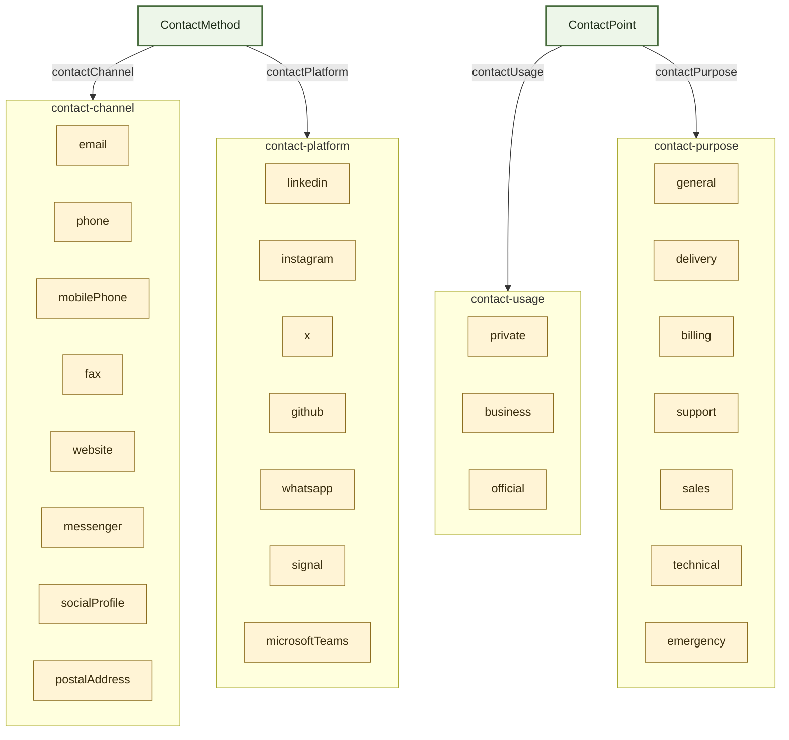

# Fachliches Kontakt-Konzeptdiagramm

**Status:** Fachliches Modell der T-Box und Core Shapes 0.1.0  
**Stand:** 27. August 2026

Die Diagramme zeigen das umgesetzte Kontaktmodell in fünf Sichten: Kernmodell, private/berufliche Kontakte, postalische Adresse, Referenzvokabulare und Quellenabbildung.

## 1. Kernmodell

## 2. Private und berufliche Erreichbarkeit

## 3. Postalische Kontaktadresse

## 4. A-Box-Vokabulare

## 5. Quellenabbildung

## 6. Modellentscheidungen

1. `ContactPoint` ist ein Kontaktblock, kein einzelnes Telefonnummernfeld.
2. `ContactMethod` ist die kleinste validierbare Einheit eines konkreten Kommunikationskanals.
3. Privat, beruflich und offiziell werden am Kontaktpunkt modelliert.
4. Lieferung, Rechnung und Support sind Zwecke und keine Nutzungskontexte.
5. Social Profiles werden generisch modelliert und können über Plattformressourcen typisiert werden.
6. Postalische Kontaktadressen referenzieren `conx-addr:AddressAssignment`.
7. Die inverse Beziehung bleibt optional.
8. `hasContactPoint` besitzt keine harte `rdfs:domain`, damit spätere Kontaktträger nicht unbeabsichtigt als Agent inferiert werden.
