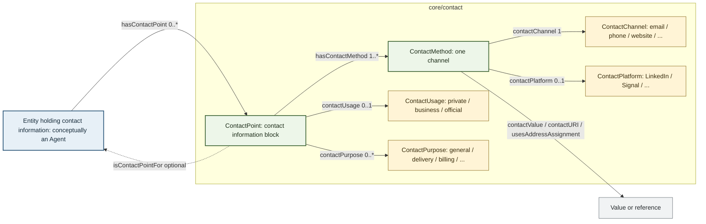
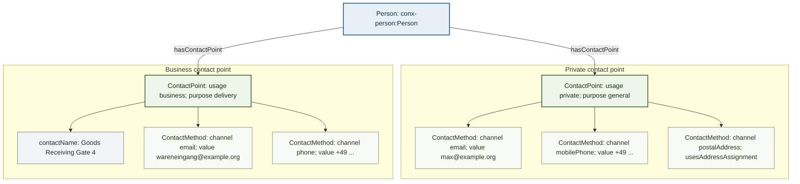
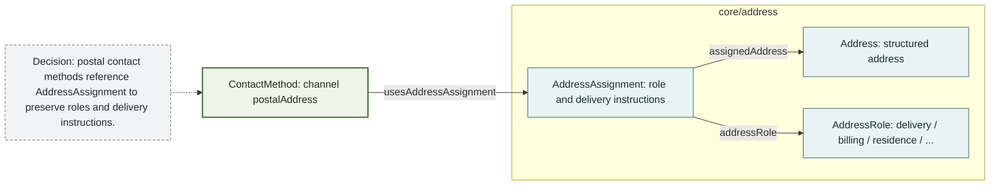
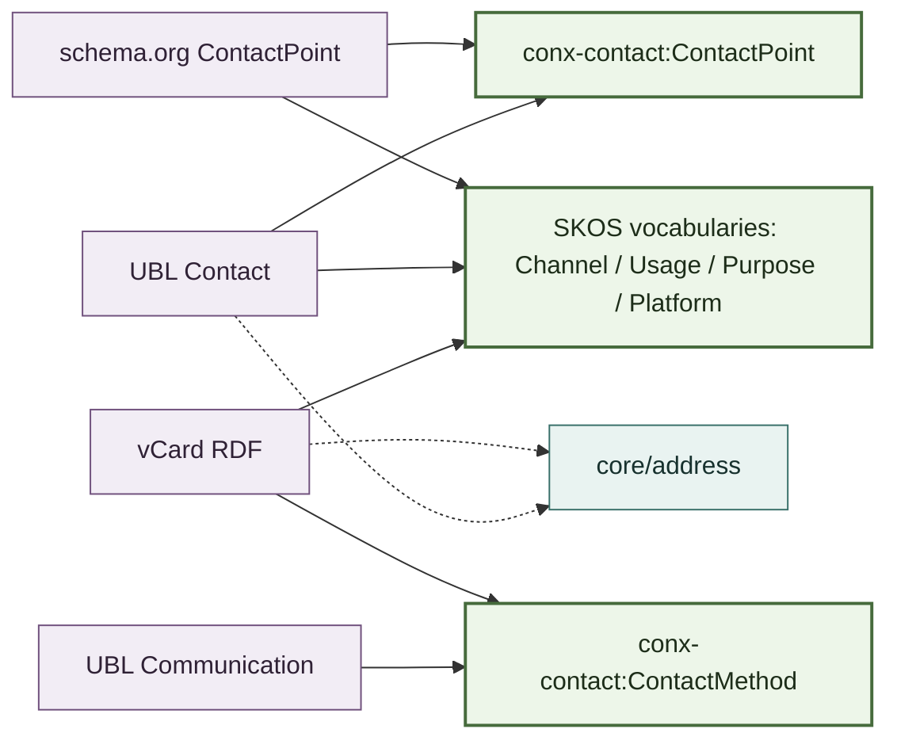

# Domain Concept Diagram for Contact

**Status:** Domain model of T-Box and Core Shapes 0.1.0  
**As of:** 27 August 2026

The diagrams show the implemented contact model from five perspectives: core model, private/business contacts, postal address, reference vocabularies, and source mappings.

## 1. Core Model

## 2. Private and Business Contactability

## 3. Postal Contact Address

## 4. A-Box Vocabularies

```mermaid
flowchart TB
    Method["ContactMethod"]
    Point["ContactPoint"]

    subgraph CHANNEL["contact-channel"]
        direction TB
        Email["email"]
        Phone["phone"]
        Mobile["mobilePhone"]
        Fax["fax"]
        Website["website"]
        Messenger["messenger"]
        Social["socialProfile"]
        Postal["postalAddress"]
    end

    subgraph USAGE["contact-usage"]
        direction TB
        Private["private"]
        Business["business"]
        Official["official"]
    end

    subgraph PURPOSE["contact-purpose"]
        direction TB
        General["general"]
        Delivery["delivery"]
        Billing["billing"]
        Support["support"]
        Sales["sales"]
        Technical["technical"]
        Emergency["emergency"]
    end

    subgraph PLATFORM["contact-platform"]
        direction TB
        Linkedin["linkedin"]
        Instagram["instagram"]
        X["x"]
        Github["github"]
        WhatsApp["whatsapp"]
        Signal["signal"]
        Teams["microsoftTeams"]
    end

    Point -->|"contactUsage"| USAGE
    Point -->|"contactPurpose"| PURPOSE
    Method -->|"contactChannel"| CHANNEL
    Method -->|"contactPlatform"| PLATFORM

    classDef core fill:#edf6e9,stroke:#466b3c,color:#1d2d19,stroke-width:2px;
    classDef vocab fill:#fff4d6,stroke:#8c6d1f,color:#392d0e;

    class Method,Point core;
    class Email,Phone,Mobile,Fax,Website,Messenger,Social,Postal,Private,Business,Official,General,Delivery,Billing,Support,Sales,Technical,Emergency,Linkedin,Instagram,X,Github,WhatsApp,Signal,Teams vocab;
```

## 5. Source Mappings

## 6. Modeling Decisions

1. `ContactPoint` is a contact information block, rather than a single telephone number field.
2. `ContactMethod` is the smallest independently validatable unit of a specific communication channel.
3. Private, business, and official usage are modeled on the contact point.
4. Delivery, billing, and support are purposes rather than usage contexts.
5. Social profiles are modeled generically and may be classified through platform resources.
6. Postal contact addresses reference `conx-addr:AddressAssignment`.
7. The inverse relationship remains optional.
8. `hasContactPoint` has no restrictive `rdfs:domain`, preventing future entities holding contact information from being unintentionally inferred as Agents.