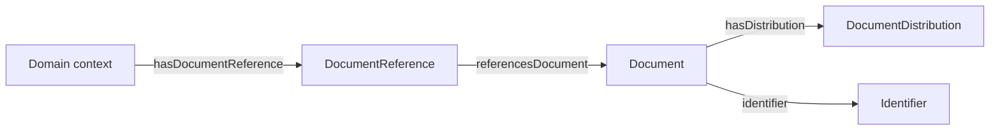

# Concept Diagram of the Document Module

**Status:** Implemented Documentation View  
**Version:** 0.1.0  
**As of:** 3 September 2026  
**Scope:** `core/document`

## 1. Core Model

## 2. Illustrative Example

> A contract references an inspection report. The inspection report is the domain-level document; its PDF file is a specific distribution.

## 3. Further Details

Additional views are provided in the [Detailed Document Concept Diagram](diagrams/document-concept-model.md).
