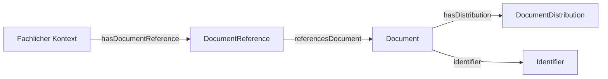

# Konzeptdiagramm des Document-Moduls

**Status:** Implementierte Dokumentationssicht  
**Version:** 0.1.0  
**Stand:** 3. September 2026  
**Geltungsbereich:** `core/document`

## 1. Kernmodell

## 2. Lesebeispiel

> Ein Vertrag verweist auf einen Prüfbericht. Der Prüfbericht ist das fachliche
> Dokument; seine PDF-Datei ist eine konkrete Distribution.

## 3. Vertiefung

Weitere Sichten enthält das
[ausführliche Document-Konzeptdiagramm](document-concept-model.md).
