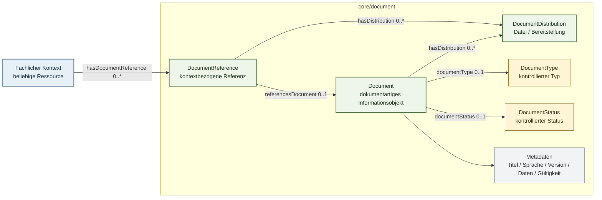
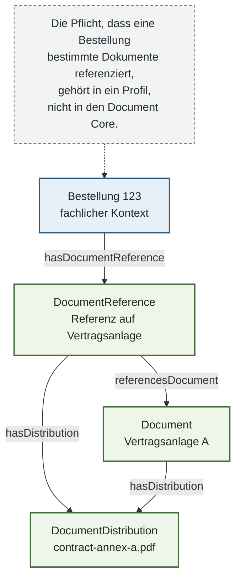
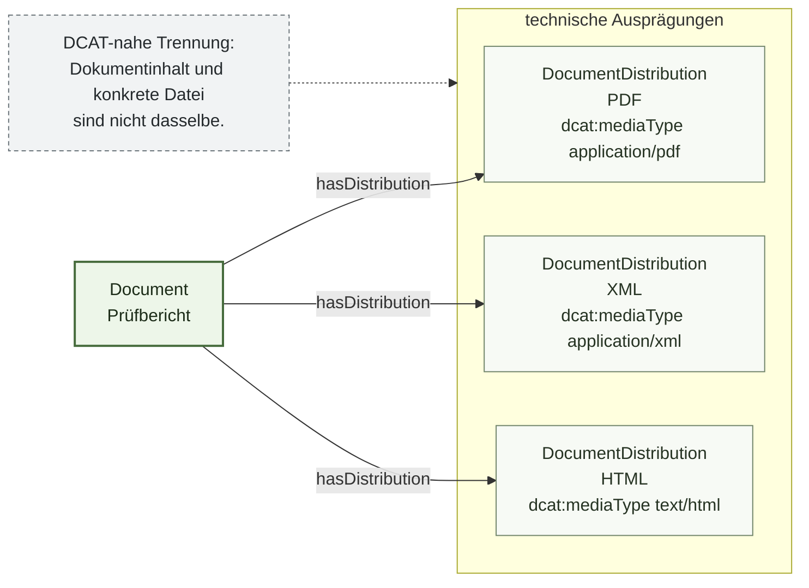
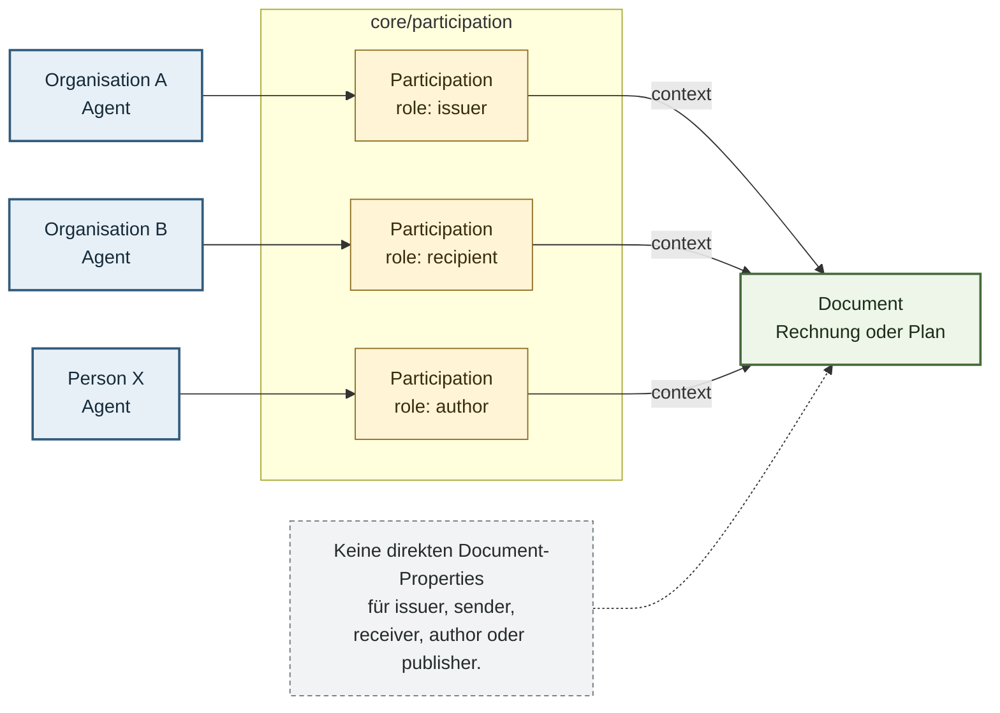
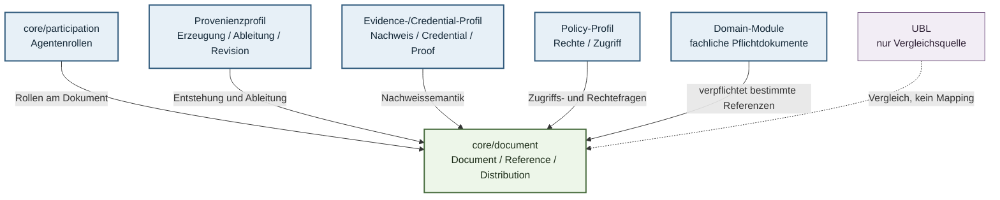

# Fachliches Document-Konzeptdiagramm

**Status:** Umgesetztes fachliches Zielbild 0.1.0  
**Stand:** 1. September 2026

Die Diagramme zeigen das umgesetzte Document-Core-Modell in fünf Sichten:
Kernmodell, Kontextreferenz, Distributionen, Akteursrollen und
Modulabgrenzung.

## 1. Kernmodell

## 2. Dokumentreferenz im fachlichen Kontext

## 3. Distributionen

## 4. Akteursrollen über Participation

## 5. Modulabgrenzung

## 6. Modellentscheidungen

1. `Document` ist eine eigene Construct-X-Klasse.
2. `DocumentReference` ist ein eigener Beziehungsknoten für kontextbezogene
   Dokumentverweise.
3. `DocumentDistribution` trennt konkrete Dateien vom dokumentartigen Inhalt.
4. Dokumenttyp und Dokumentstatus werden kontrollierte Vokabulare.
5. Aussteller, Sender, Empfänger, Autor und Publisher werden über
   `core/participation` modelliert.
6. PROV-O ist nur für Entstehung, Ableitung, Revision und Verarbeitung
   relevant.
7. UBL bleibt Vergleichsquelle und wird nicht als Abhängigkeit eingeführt.
8. Gültigkeit wird optional über `validFrom` und `validUntil` beschrieben.
9. Distributionen verwenden `dcat:accessURL`, `dcat:downloadURL` und
   `dcat:mediaType` direkt.
