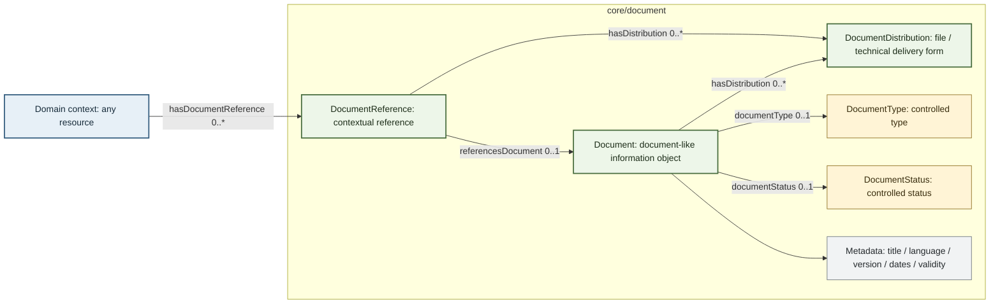
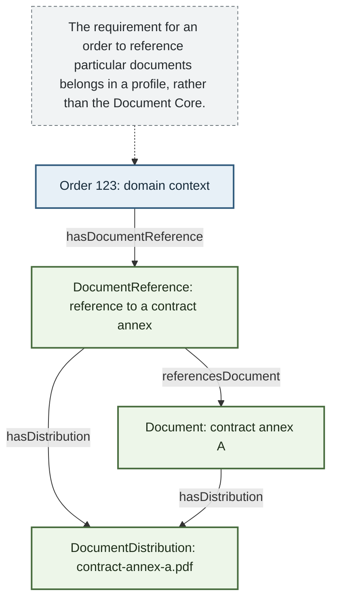
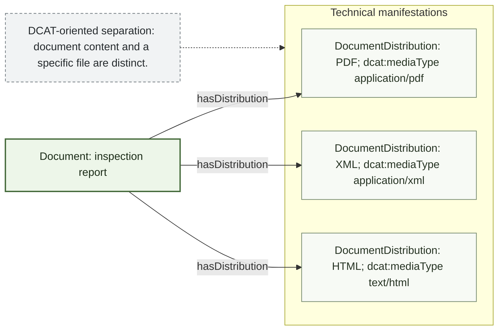
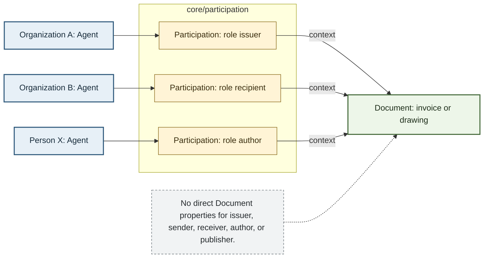
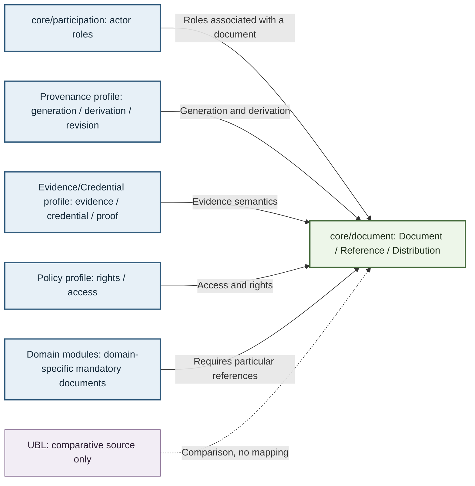

# Domain Concept Diagram for Document

**Status:** Implemented domain target model 0.1.0  
**As of:** 1 September 2026

The diagrams show the implemented Document Core model from five perspectives: core model, contextual reference, distributions, actor roles, and module boundaries.

## 1. Core Model

## 2. Document Reference in a Domain Context

## 3. Distributions

## 4. Actor Roles through Participation

## 5. Module Boundaries

## 6. Modeling Decisions

1. `Document` is a dedicated Construct-X class.
2. `DocumentReference` is a separate relationship node for contextual document references.
3. `DocumentDistribution` separates specific files from document-like content.
4. Document type and document status are represented through controlled vocabularies.
5. Issuer, sender, recipient, author, and publisher are modeled through `core/participation`.
6. PROV-O is relevant only to generation, derivation, revision, and processing.
7. UBL remains a comparative source and is not introduced as a dependency.
8. Validity is optionally described through `validFrom` and `validUntil`.
9. Distributions directly use `dcat:accessURL`, `dcat:downloadURL`, and `dcat:mediaType`.