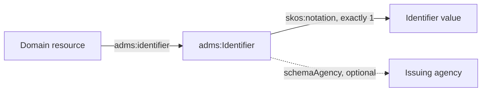

# Concept Diagram of the Identifier Module

**Status:** Implemented Documentation View  
**Version:** 0.1.0  
**As of:** 3 September 2026  
**Scope:** `core/identifier`

## 1. Core Model

## 2. Illustrative Example

> The organization references an identifier resource. This resource contains the actual registration number and, optionally, the responsible register.

## 3. Further Details

Details are provided in the [Conceptual Model](03_concept-model.md).