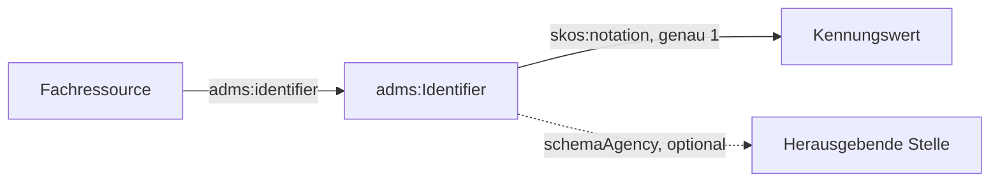

# Konzeptdiagramm des Identifier-Moduls

**Status:** Implementierte Dokumentationssicht  
**Version:** 0.1.0  
**Stand:** 3. September 2026  
**Geltungsbereich:** `core/identifier`

## 1. Kernmodell

## 2. Lesebeispiel

> Die Organisation verweist auf eine Kennungsressource. Dort stehen die
> eigentliche Registernummer und optional das verantwortliche Register.

## 3. Vertiefung

Details stehen im [Konzeptmodell](../concept-model.md).
