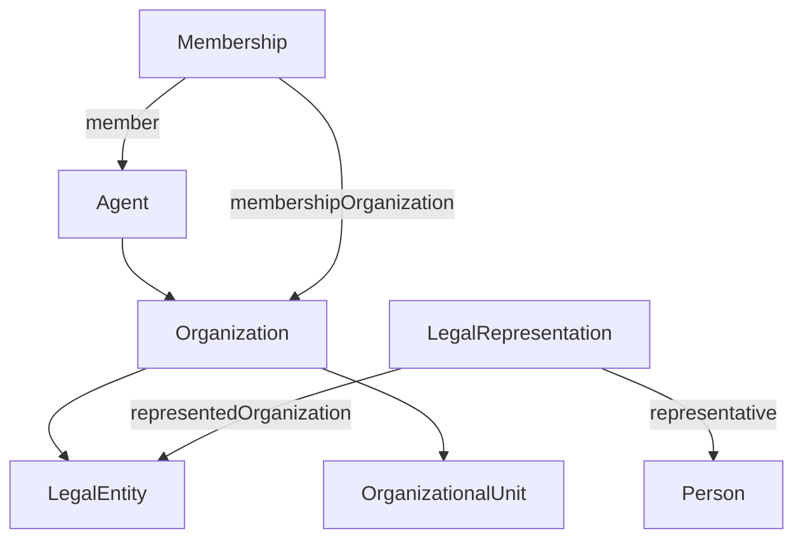

# Concept Diagram of the Organization Module

**Status:** Implemented Documentation View  
**Version:** 0.1.0  
**As of:** 3 September 2026  
**Scope:** `core/organization`

## 1. Core Model

## 2. Illustrative Example

> A Person may be a member of an Organization and simultaneously legally represent a Legal Entity. These are two distinct relationships and therefore two separate resources.

## 3. Further Details

Additional views are provided in the [Detailed Organization Diagram](diagrams/organization-concept-model.md).
