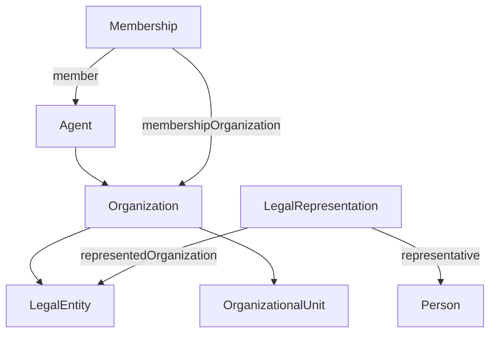

# Konzeptdiagramm des Organization-Moduls

**Status:** Implementierte Dokumentationssicht  
**Version:** 0.1.0  
**Stand:** 3. September 2026  
**Geltungsbereich:** `core/organization`

## 1. Kernmodell

## 2. Lesebeispiel

> Eine Person kann Mitglied einer Organisation sein und zugleich eine Legal
> Entity rechtlich vertreten. Das sind zwei unterschiedliche Beziehungen und
> deshalb zwei eigene Ressourcen.

## 3. Vertiefung

Weitere Sichten enthält das
[ausführliche Organisationsdiagramm](organization-concept-model.md).
