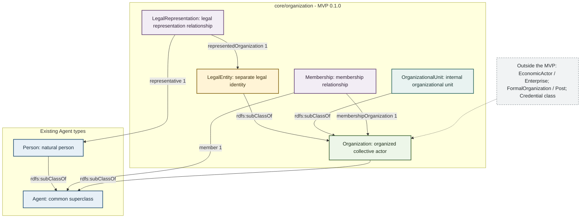
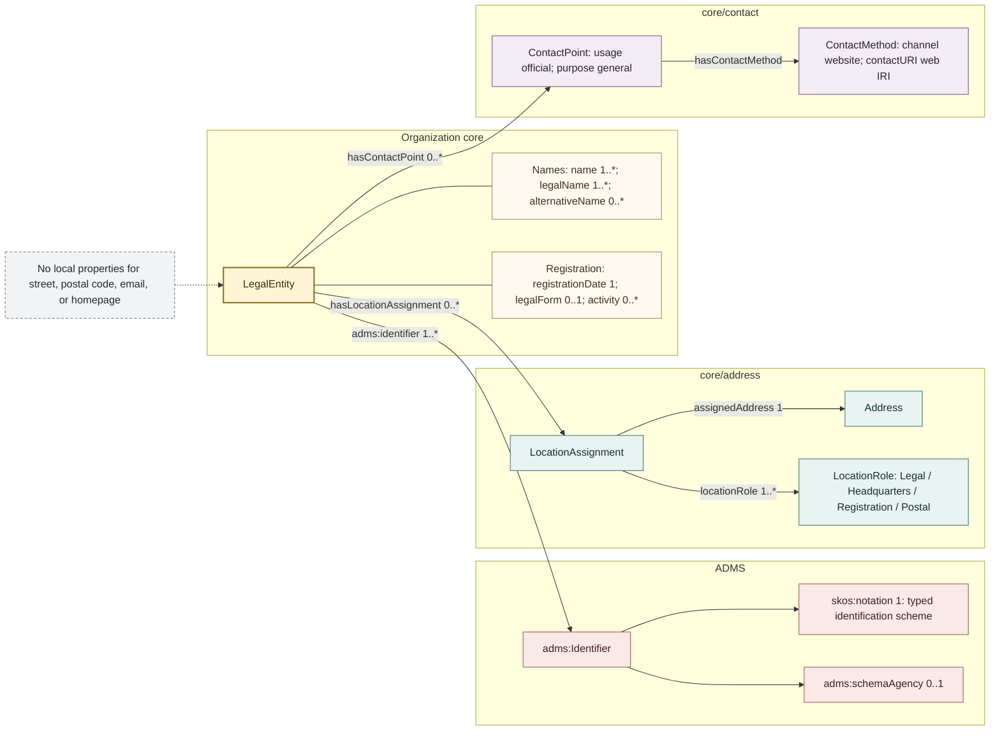
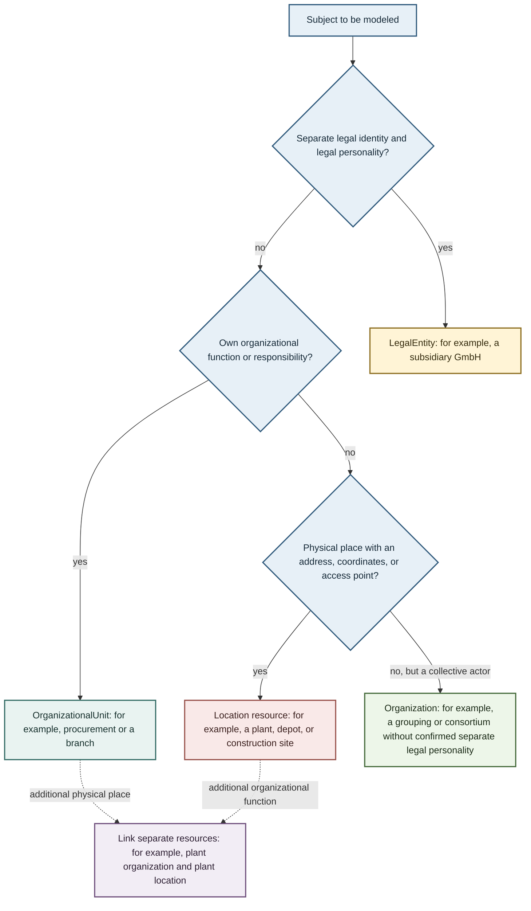
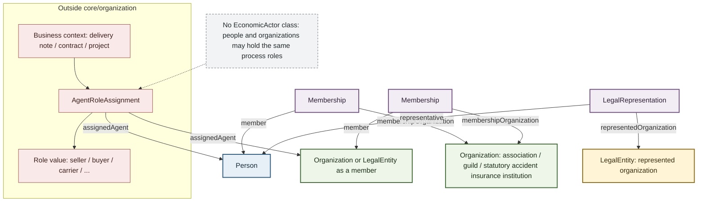

# Domain Organization Diagram

**Status:** Domain model of implemented version 0.1.0  
**As of:** 27 August 2026  
**Implementation status:** T-Box and Core Shapes 0.1.0 implemented

The model is presented from four perspectives, keeping the class hierarchy, master data, organizational parts, and process roles separately readable.

## 1. Classes and Relationships

### How to Read the Diagram

1. `Organization` is the common local organization class.
2. `LegalEntity` and `OrganizationalUnit` are distinct specializations.
3. Membership and representation are resources rather than direct text attributes.
4. A Person may be a member or legal representative without becoming an Organization instance.

## 2. Organizational Master Data and Connections Between Modules

### Homepage Example

| Resource | Property | Value or Target |
| --- | --- | --- |
| `LegalEntity` | `hasContactPoint` | `ContactPoint` |
| `ContactPoint` | `contactUsage` | `official` |
| `ContactPoint` | `contactPurpose` | `general` |
| `ContactPoint` | `hasContactMethod` | `ContactMethod` |
| `ContactMethod` | `contactChannel` | `website` |
| `ContactMethod` | `contactURI` | `https://example.org/` |

The homepage is therefore represented entirely within the existing Contact model.

## 3. Organizational Unit, Location, or Legal Entity

### Typical Classification

| Subject | Result |
| --- | --- |
| Subsidiary | `LegalEntity` |
| Department | `OrganizationalUnit` |
| Branch without separate legal personality | `OrganizationalUnit` plus location |
| Plant or depot | Location; additionally an Organizational Unit if it has its own function |
| Construction site | Location or project site |
| Corporate group or organizational grouping | `Organization`, not automatically `LegalEntity` |

## 4. Membership, Representation, and Process Role

### Boundaries

- `Membership` describes membership in an Organization.
- `LegalRepresentation` describes legal representation of a Legal Entity.
- `AgentRoleAssignment` describes a function within a specific transaction or process.
- `Post` would describe a permanent position and is outside the MVP.

## 5. Modeling Decisions

1. `Organization` is a subclass of the existing `Agent`.
2. `LegalEntity` and `OrganizationalUnit` are not synonyms.
3. An Organizational Unit is not automatically a location; the two are linked as separate resources where required.
4. A subsidiary with its own legal identity is a `LegalEntity`, rather than merely an `OrganizationalUnit`.
5. Sole traders and freelancers remain people.
6. Economic activity is expressed through process roles; there is no local `EconomicActor` class.
7. Membership and legal representation are separate relationship resources.
8. Representation data references a Person without duplicating personal properties.
9. Membership numbers identify the Membership rather than generally identifying the member.
10. Addresses, contacts, and identifiers use existing modules and vocabularies.
11. A homepage is an official general website contact method.
12. `FormalOrganization`, `Post`, a Credential class, and jurisdiction profiles remain outside the MVP.