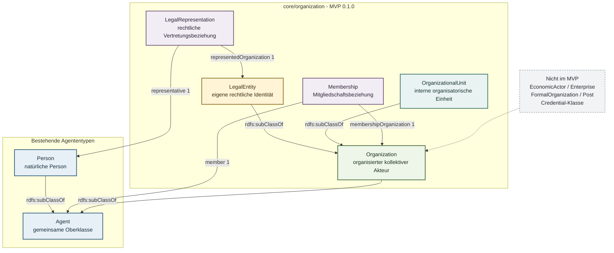
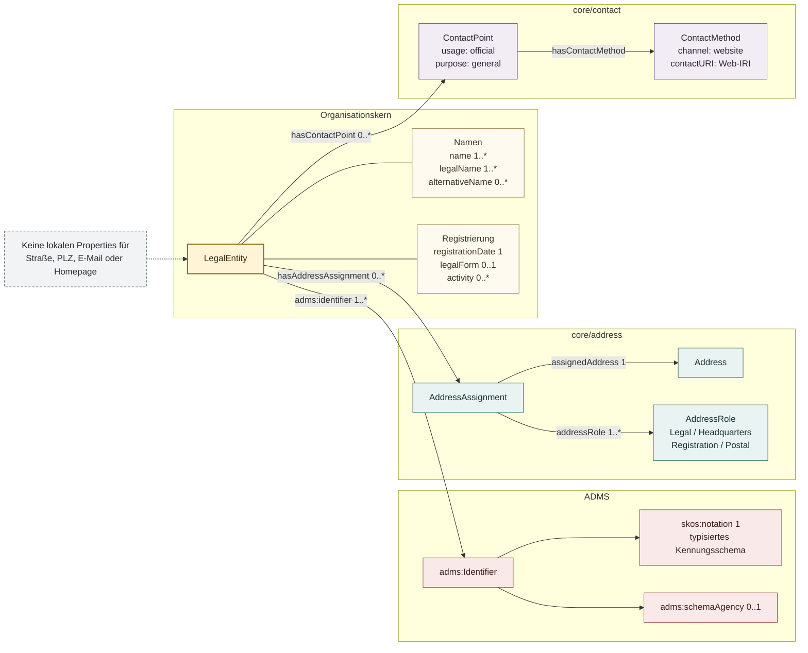
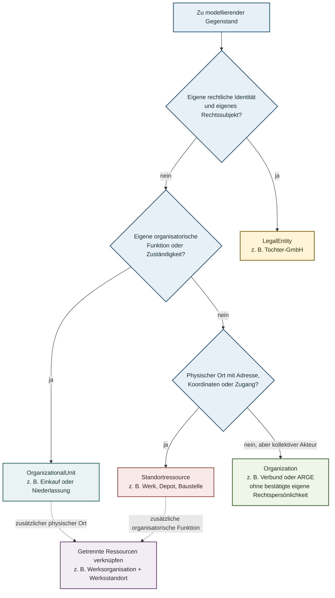
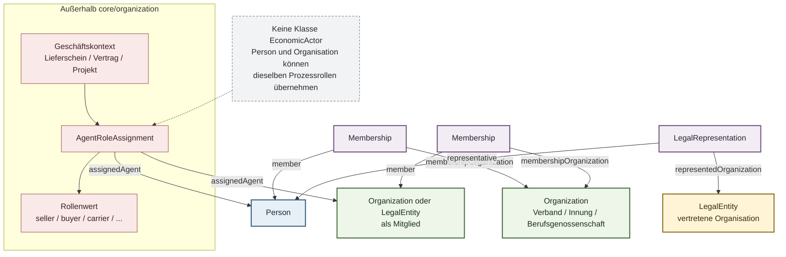

# Fachliches Organisationsdiagramm

**Status:** Fachliches Modell der implementierten Version 0.1.0  
**Stand:** 27. August 2026  
**Umsetzungsstand:** T-Box und Core Shapes 0.1.0 implementiert

Die Darstellung ist in vier Sichten gegliedert. Dadurch bleiben
Klassenhierarchie, Stammdaten, Organisationsteile und Prozessrollen getrennt
lesbar.

## 1. Klassen und Beziehungen



### Leseregeln

1. `Organization` ist die gemeinsame lokale Organisationsklasse.
2. `LegalEntity` und `OrganizationalUnit` sind unterschiedliche Spezialisierungen.
3. Mitgliedschaft und Vertretung sind Ressourcen, keine direkten Textattribute.
4. Eine Person kann Mitglied oder rechtliche Vertretung sein, ohne
   Organisationsinstanz zu werden.

## 2. Organisationsstammdaten und Modulübergänge



### Homepage-Beispiel

```text
LegalEntity
  -> hasContactPoint
       -> contactUsage: official
       -> contactPurpose: general
       -> hasContactMethod
            -> contactChannel: website
            -> contactURI: https://example.org/
```

Die Homepage ist damit vollständig im bestehenden Kontaktmodell abgebildet.

## 3. Organisationseinheit, Standort oder Legal Entity



### Typische Zuordnung

| Gegenstand | Ergebnis |
| --- | --- |
| Tochtergesellschaft | `LegalEntity` |
| Abteilung | `OrganizationalUnit` |
| Niederlassung ohne eigene Rechtspersönlichkeit | `OrganizationalUnit` plus Standort |
| Werk oder Depot | Standort; zusätzlich Organisationseinheit bei eigener Funktion |
| Baustelle | Standort beziehungsweise Projektort |
| Konzern oder Organisationsverbund | `Organization`, nicht automatisch `LegalEntity` |

## 4. Mitgliedschaft, Vertretung und Prozessrolle



### Abgrenzung

- `Membership` beschreibt Zugehörigkeit zu einer Organisation.
- `LegalRepresentation` beschreibt rechtliche Vertretung einer Legal Entity.
- `AgentRoleAssignment` beschreibt eine Funktion in einem konkreten Vorgang.
- `Post` würde eine dauerhaft eingerichtete Stelle beschreiben und ist nicht im
  MVP enthalten.

## 5. Modellentscheidungen

1. `Organization` ist Unterklasse des vorhandenen `Agent`.
2. `LegalEntity` und `OrganizationalUnit` sind keine Synonyme.
3. Eine Organisationseinheit ist nicht automatisch ein Standort; beide werden
   bei Bedarf als getrennte Ressourcen verknüpft.
4. Eine Tochtergesellschaft mit eigener rechtlicher Identität ist
   `LegalEntity`, keine bloße `OrganizationalUnit`.
5. Einzelunternehmen und Freiberufler bleiben Personen.
6. Wirtschaftliches Handeln wird über Prozessrollen ausgedrückt; es gibt keine
   lokale Klasse `EconomicActor`.
7. Mitgliedschaft und rechtliche Vertretung sind eigenständige
   Beziehungsressourcen.
8. Vertretungsdaten referenzieren eine Person und duplizieren keine
   Personeneigenschaften.
9. Mitgliedsnummern identifizieren die Membership, nicht pauschal das Mitglied.
10. Adressen, Kontakte und Identifier verwenden bestehende Module und
    Vokabulare.
11. Eine Homepage ist eine offizielle allgemeine Website-Kontaktmethode.
12. `FormalOrganization`, `Post`, Credential-Klasse und Jurisdiktionsprofile
    bleiben außerhalb des MVP.
