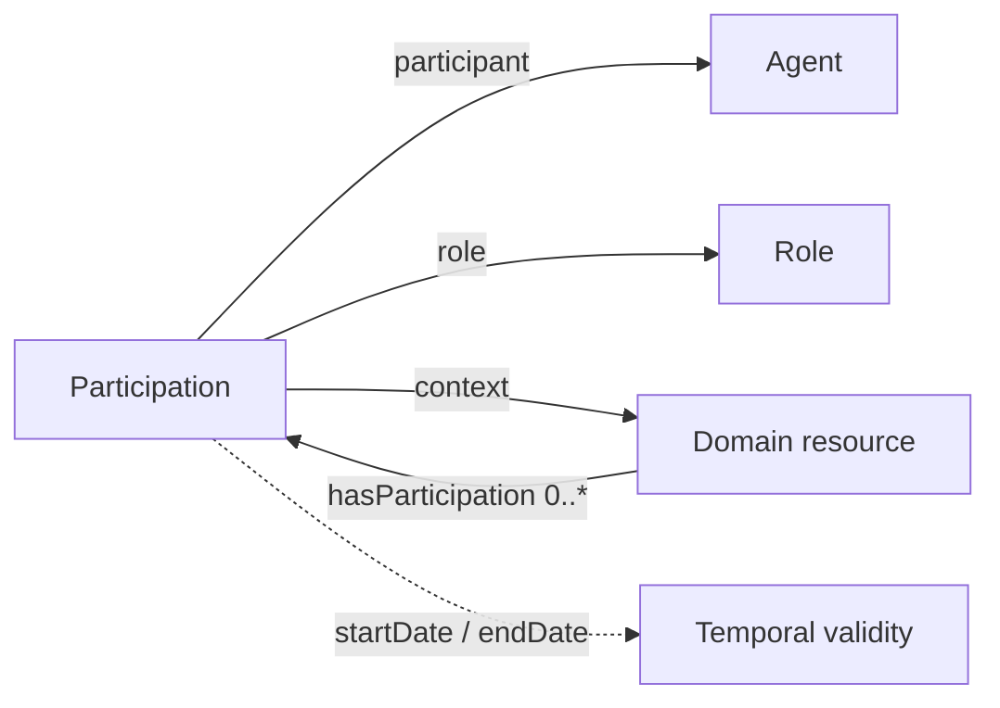

# Concept Diagram of the Participation Module

**Status:** Implemented Documentation View  
**Version:** 0.2.0  
**As of:** 7 October 2026  
**Scope:** `core/participation`

## 1. Core Model

## 2. Illustrative Example

> A Person is involved as the Architect in a construction project. Participation links Person, role, and construction project without conflating these concepts.

## 3. Further Details

Additional views are provided in the [Detailed Participation Diagram](diagrams/participation-concept-model.md).
