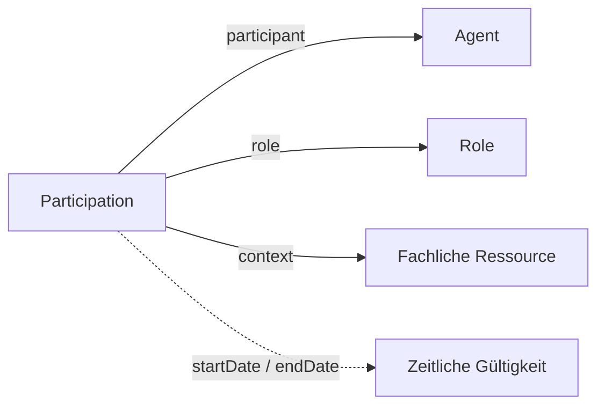

# Konzeptdiagramm des Participation-Moduls

**Status:** Implementierte Dokumentationssicht  
**Version:** 0.1.0  
**Stand:** 3. September 2026  
**Geltungsbereich:** `core/participation`

## 1. Kernmodell

## 2. Lesebeispiel

> Eine Person ist in einem Bauvorhaben als Architektin beteiligt. Participation
> verbindet Person, Rolle und Bauvorhaben, ohne einen dieser Begriffe zu
> vermischen.

## 3. Vertiefung

Weitere Sichten enthält das
[ausführliche Participation-Diagramm](participation-concept-model.md).
