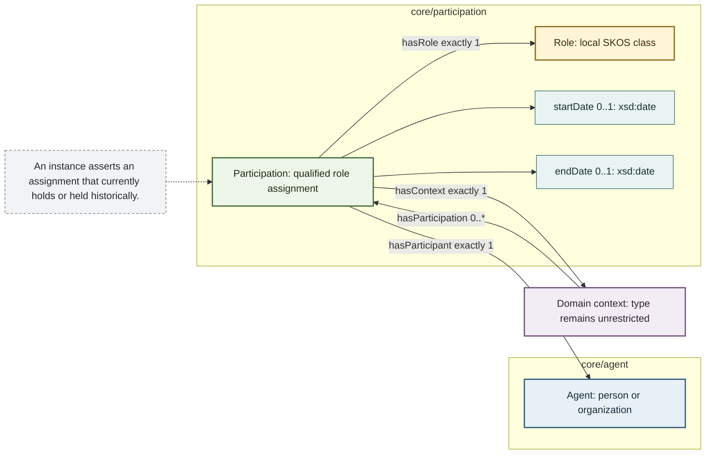
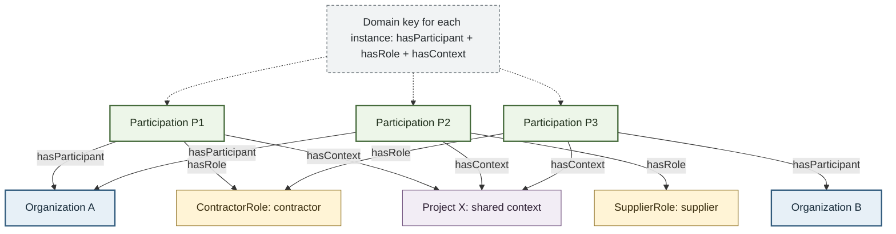
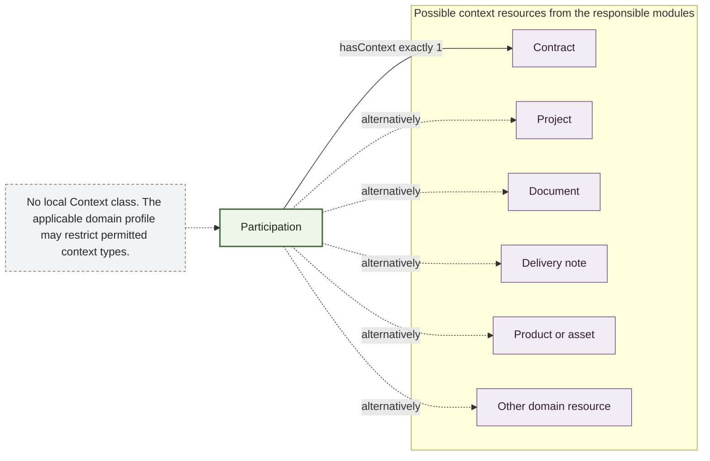
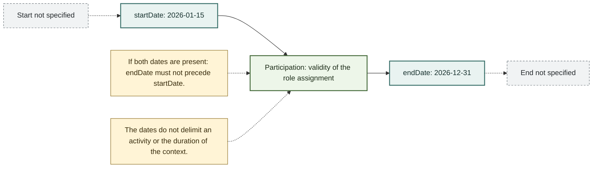
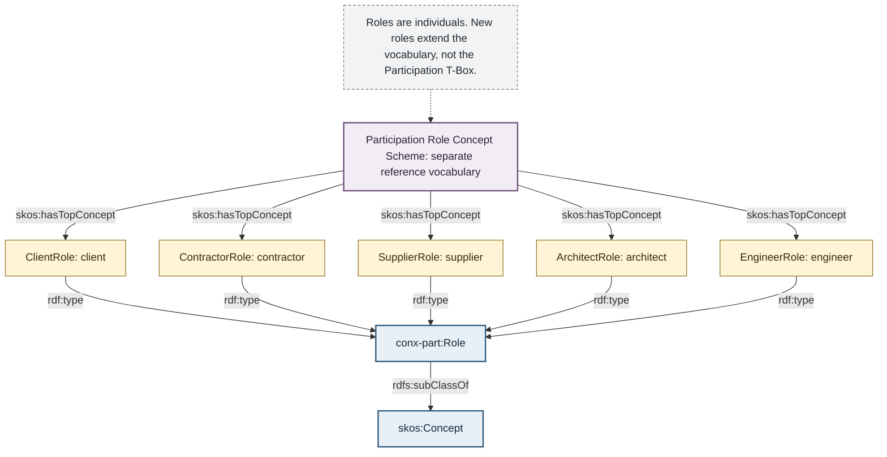
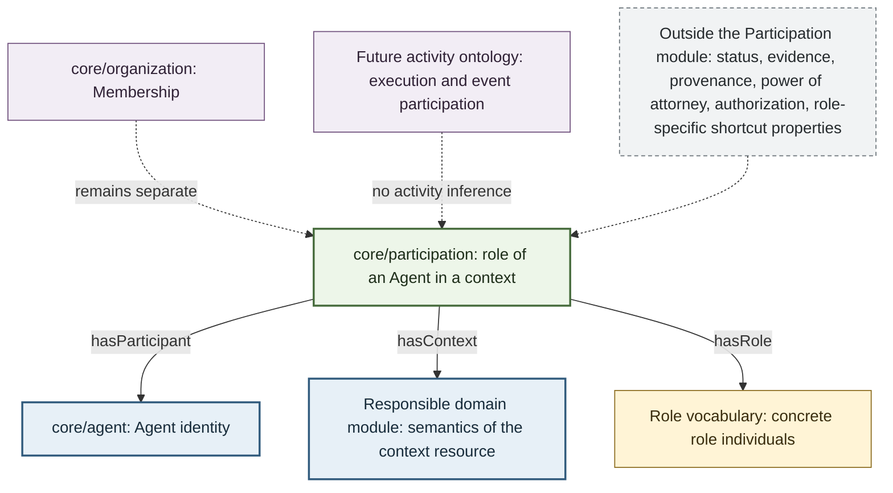

# Participation Domain Diagrams

**Status:** Conceptual diagrams of the implemented version 0.3.0  
**Version:** 0.3.0  
**Scope:** `core/participation`  
**As of:** 19 November 2026

The Mermaid diagrams show the confirmed Participation model from six perspectives: the core model, separate combinations, unrestricted context, temporal validity, role vocabulary, and module boundaries.

## 1. Core Model

### Reading Guidelines

1. Each Participation has exactly one Agent.
2. Each Participation has exactly one role value.
3. Each Participation has exactly one context.
4. Start and end dates are optional and describe validity only.
5. The context is not restricted by a local class.

## 2. One Instance per Combination

### Meaning of the Diagram

- Organization A has two roles in the same project and therefore two Participations.
- Organization A and Organization B have the same role in the same project and therefore each have their own Participation.
- No Participation combines multiple Agents or roles.

## 3. Unrestricted Domain Context

The dashed edges indicate alternatives. An individual Participation always uses exactly one of these context resources.

## 4. Optional Temporal Validity

### Permitted Date Combinations

| Start date | End date | Meaning |
| --- | --- | --- |
| Absent | Absent | Temporal boundaries are not specified |
| Present | Absent | The start is specified, but the end is not |
| Absent | Present | The end is specified, but the start is not |
| Present | Present | Validity is bounded at both ends |

## 5. Roles as SKOS Individuals

The five roles shown are the proposal from the term catalog. The diagram does not yet assert that a dataset has been implemented.

## 6. Module Boundaries

## 7. Modeling Decisions

1. Participation is a qualified role assignment rather than participation in an activity.
2. Each Participation has exactly one Agent, one role, and one context.
3. The combination of these three values is unique within the domain.
4. Roles are individuals of a local, SKOS-based class.
5. Context types are defined by domain profiles rather than the Core.
6. Start and end dates are optional boundaries of assignment validity.
7. Membership and Participation remain independent.
8. The Core contains no role-specific shortcut properties, status values, or evidence values.
9. `hasParticipation` is the optional reverse relationship from the context; the three core relationships on Participation remain explicitly present.