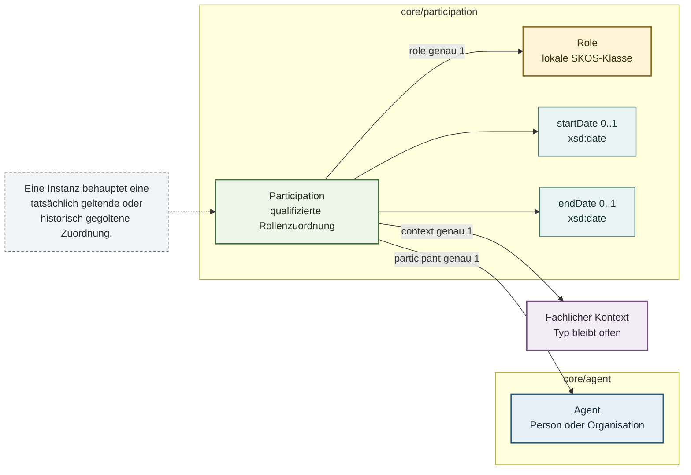
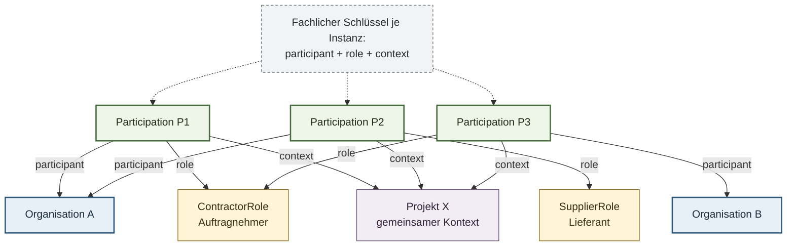
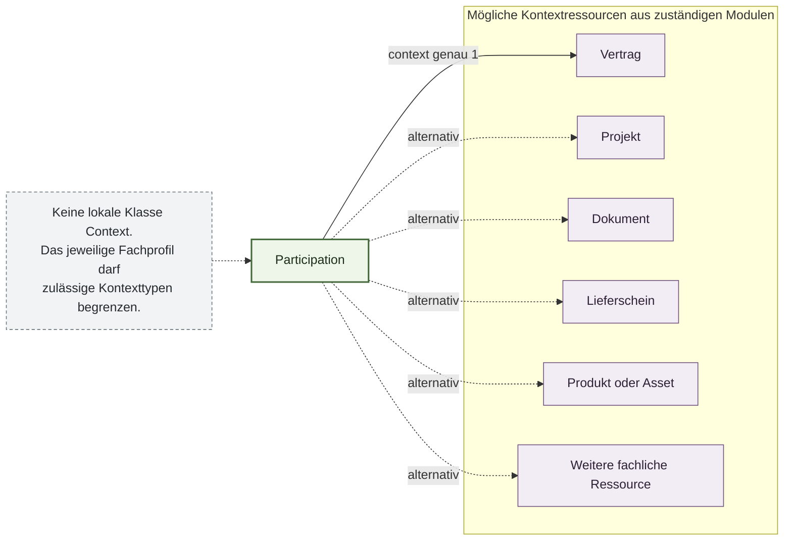
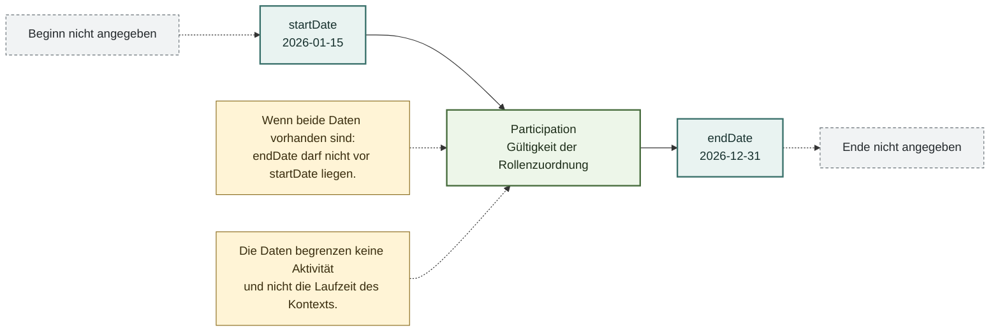
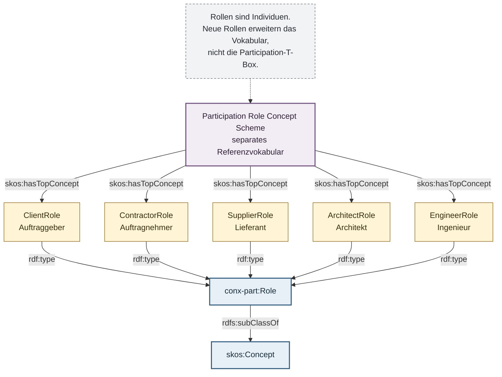
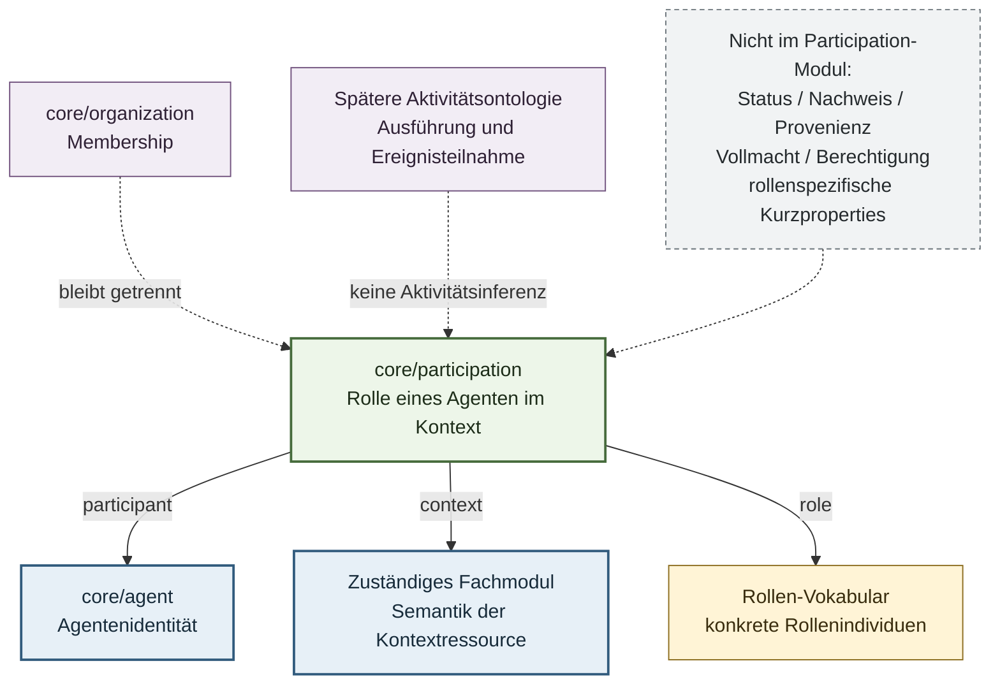

# Fachliche Participation-Diagramme

**Status:** Konzeptdiagramme der implementierten Version 0.1.0  
**Stand:** 27. August 2026

Die Mermaid-Diagramme zeigen das bestätigte Participation-Modell in sechs
Sichten: Kernmodell, getrennte Kombinationen, offener Kontext, zeitliche
Gültigkeit, Rollen-Vokabular und Modulgrenzen.

## 1. Kernmodell

### Leseregeln

1. Jede Participation besitzt genau einen Agenten.
2. Jede Participation besitzt genau einen Rollenwert.
3. Jede Participation besitzt genau einen Kontext.
4. Start- und Enddatum sind optional und beschreiben nur die Gültigkeit.
5. Der Kontext wird nicht durch eine lokale Klasse eingeschränkt.

## 2. Eine Instanz pro Kombination

### Aussage des Diagramms

- Organisation A besitzt zwei Rollen im selben Projekt und deshalb zwei
  Participations.
- Organisation A und Organisation B besitzen dieselbe Rolle im selben Projekt
  und deshalb jeweils eine eigene Participation.
- Keine Participation bündelt mehrere Agenten oder Rollen.

## 3. Offener fachlicher Kontext

Die gestrichelten Kanten zeigen Alternativen. Eine einzelne Participation
verwendet immer genau eine dieser Kontextressourcen.

## 4. Optionale zeitliche Gültigkeit

### Erlaubte Datumsvarianten

| Startdatum | Enddatum | Bedeutung |
| --- | --- | --- |
| fehlt | fehlt | Zeitliche Grenzen sind nicht angegeben |
| vorhanden | fehlt | Beginn ist angegeben, Ende nicht |
| fehlt | vorhanden | Ende ist angegeben, Beginn nicht |
| vorhanden | vorhanden | Gültigkeit ist beidseitig begrenzt |

## 5. Rollen als SKOS-Individuen

Die dargestellten fünf Rollen sind der Vorschlag des Begriffskatalogs. Das
Diagramm behauptet noch keinen implementierten Datensatz.

## 6. Modulgrenzen

## 7. Modellentscheidungen

1. Participation ist eine qualifizierte Rollenzuordnung und keine
   Aktivitätsteilnahme.
2. Agent, Rolle und Kontext kommen pro Participation jeweils genau einmal vor.
3. Die Kombination aus diesen drei Werten ist fachlich eindeutig.
4. Rollen sind Individuen einer lokalen, SKOS-basierten Klasse.
5. Kontexttypen werden von Fachprofilen und nicht vom Core festgelegt.
6. Start- und Enddatum sind optionale Grenzen der Zuordnungsgültigkeit.
7. Membership und Participation bleiben unabhängig.
8. Es gibt keine rollenspezifischen Kurzproperties, Status- oder Nachweiswerte.
