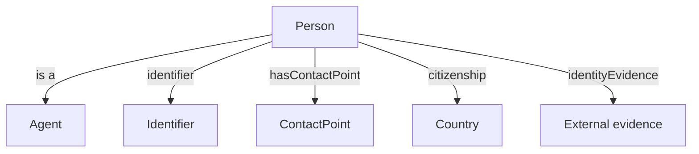

# Conceptual Diagram of the Person Module

**Status:** Implemented documentation view  
**Version:** 0.1.0  
**As of:** 3 September 2026  
**Scope:** `core/person`

## 1. Core Model

## 2. Illustrative Example

> Names and birth details describe the Person directly. Contact point, citizenship, identifier, and evidence are linked resources with their own areas of responsibility.

## 3. Further Details

Additional views are provided in the [Detailed Person Diagram](diagrams/person-concept-model.md).
