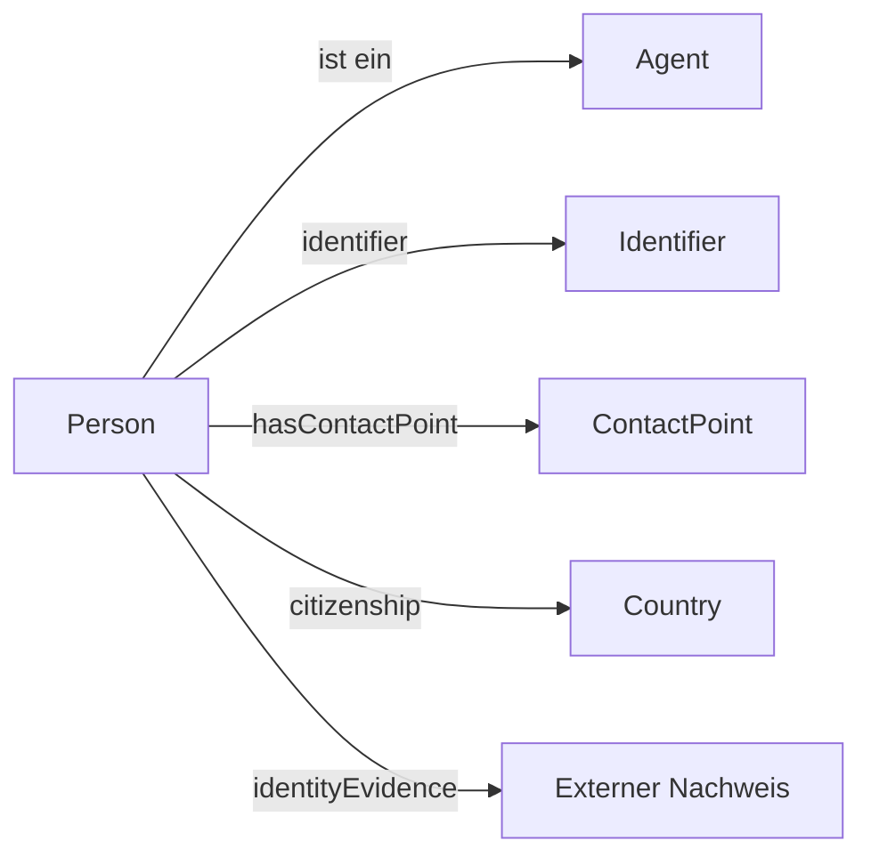

# Konzeptdiagramm des Person-Moduls

**Status:** Implementierte Dokumentationssicht  
**Version:** 0.1.0  
**Stand:** 3. September 2026  
**Geltungsbereich:** `core/person`

## 1. Kernmodell

## 2. Lesebeispiel

> Namen und Geburtsangaben beschreiben die Person direkt. Kontaktpunkt,
> Staatsangehörigkeit, Kennung und Nachweis sind verknüpfte Ressourcen mit
> eigener Zuständigkeit.

## 3. Vertiefung

Weitere Sichten enthält das
[ausführliche Personendiagramm](person-concept-model.md).
