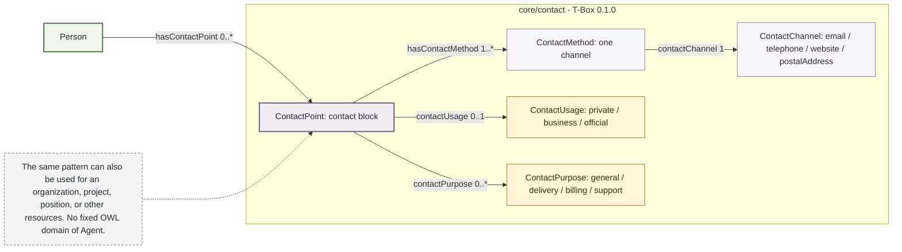
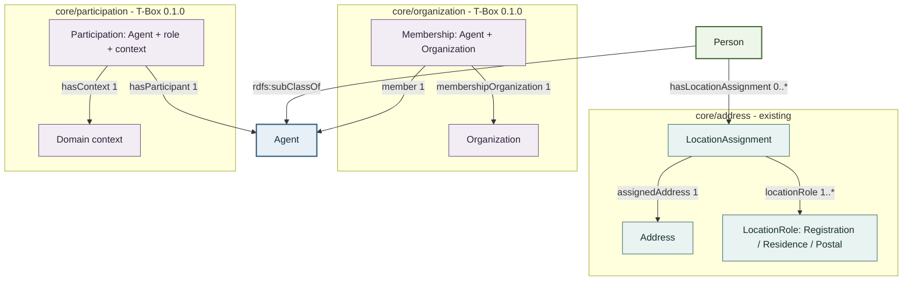

# Person Domain Diagram

**Status:** Domain model of the implemented T-Box 0.1.0 and its connections to other Core modules  
**As of:** 25 August 2026

The representation is divided into three views so that the Person core, contact modeling, and connections to other modules remain readable independently.

## 1. Person Core

```mermaid
flowchart TB
    Agent["Agent: common superclass"]

    subgraph PERSON["core/person - T-Box 0.1.0"]
        direction TB
        Person["Person: real natural person"]

        subgraph ATTRIBUTES["Literal Attributes"]
            direction LR
            Names["Names: fullName 1..* required; givenName 1..* required; familyName 0..*; additionalName 0..*; birthName 0..*"]
            Birth["Birth details: birthDate 0..1, xsd:date; birthPlaceName 0..1, literal"]
        end

        Person --- Names
        Person --- Birth
    end

    subgraph REFERENCE["Reference Data and External Structures"]
        direction LR
        Sex["Human Sex Concept: ISO/IEC 5218; 0 / 1 / 2 / 9"]
        Gender["Gender Concept: Man / Woman; Non-binary or gender-diverse; Not disclosed"]
        Country["Country: Construct-X ISO 3166-1"]
        Identifier["adms:Identifier: scheme + notation + agency"]
        Evidence["Identity Evidence: external evidence resource"]
    end

    Person -->|"rdfs:subClassOf"| Agent
    Person -->|"sex 0..1"| Sex
    Person -->|"gender 0..1"| Gender
    Person -->|"citizenship 0..*"| Country
    Person -->|"adms:identifier 0..*"| Identifier
    Person -->|"hasIdentityEvidence 0..*"| Evidence

    classDef agent fill:#e7f0f7,stroke:#315b7d,color:#172b3a,stroke-width:2px;
    classDef person fill:#edf6e9,stroke:#466b3c,color:#1d2d19,stroke-width:2px;
    classDef detail fill:#f7faf5,stroke:#71856a,color:#263323;
    classDef reference fill:#fff4d6,stroke:#8c6d1f,color:#392d0e;
    classDef identity fill:#f9e9e8,stroke:#99534d,color:#3d211f;

    class Agent agent;
    class Person person;
    class Names,Birth detail;
    class Sex,Gender,Country,Identifier reference;
    class Evidence identity;
```



## 2. Private and Business Contact Details



### Example of a Private Contact Point

```turtle
ex:person-123
    conx-contact:hasContactPoint ex:private-contact-point .

ex:private-contact-point
    a conx-contact:ContactPoint ;
    conx-contact:contactUsage contact-usage:private ;
    conx-contact:contactPurpose contact-purpose:general ;
    conx-contact:hasContactMethod ex:email-1 .

ex:email-1
    a conx-contact:ContactMethod ;
    conx-contact:contactChannel contact-channel:email ;
    conx-contact:contactValue "maria@example.org" .
```

`contact-usage:private` describes the usage context of the contact point. It does not provide access control or state who may read the contact details.

## 3. Connections to Other Modules



## 4. Modeling Decisions

1. The Person core contains only intrinsic personal data and references to reference or evidence resources.
2. The contact model is read starting from the entity holding the contact information: `Person -> hasContactPoint -> ContactPoint -> hasContactMethod -> ContactMethod`.
3. Private or business use is a usage context of the contact point rather than an intrinsic property of an individual contact value.
4. The contact purpose is modeled separately from the private or business context.
5. `hasContactPoint` has no restrictive OWL domain in the open Core. This allows organizations, projects, positions, or other identifiable resources to use the pattern without being inferred to be an `Agent`.
6. An inverse relationship, `isContactPointFor`, is not included in version 0.1.0.
7. Addresses continue to use the existing `LocationAssignment` pattern.
8. Memberships remain in the Organization module; general contextual roles are modeled using `core/participation`.

## 5. Extension Point

The Gender vocabulary initially contains `man`, `woman`, `nonBinaryOrDiverse`, and `notDisclosed`. The third value is intended as a broad umbrella concept and can later be extended with more precise, subordinate gender concepts. `notDisclosed` denotes an explicit decision not to disclose and does not represent a gender identity.