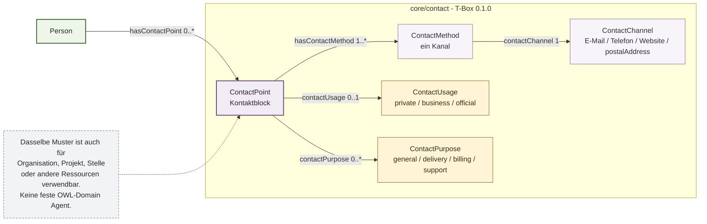
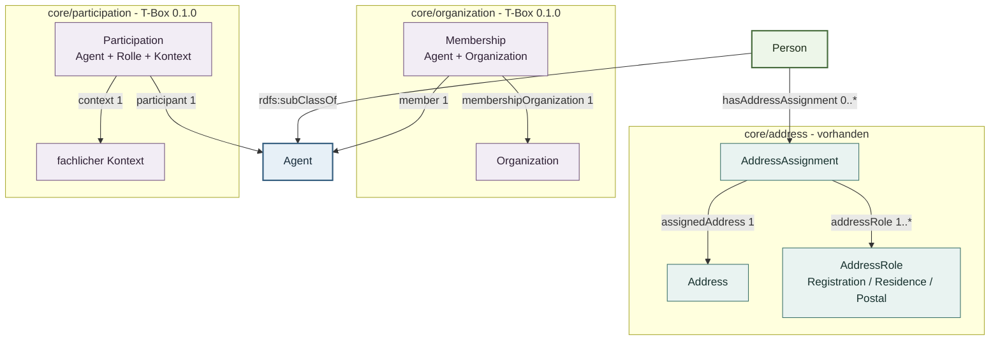

# Fachliches Personendiagramm

**Status:** Fachliches Modell der implementierten T-Box 0.1.0 und ihrer Core-Modulübergänge  
**Stand:** 25. August 2026

Die Darstellung ist in drei Sichten gegliedert. Dadurch bleiben der Personenkern, die Kontaktmodellierung und die übrigen Modulübergänge jeweils für sich lesbar.

## 1. Personenkern

```mermaid
flowchart TB
    Agent["Agent<br/>gemeinsame Oberklasse"]

    subgraph PERSON["core/person - T-Box 0.1.0"]
        direction TB
        Person["Person<br/>reale natürliche Person"]

        subgraph ATTRIBUTES["Literalattribute"]
            direction LR
            Names["Namen<br/>fullName 1..* - Pflicht<br/>givenName 1..* - Pflicht<br/>familyName 0..*<br/>additionalName 0..*<br/>birthName 0..*"]
            Birth["Geburtsdaten<br/>birthDate 0..1 - xsd:date<br/>birthPlaceName 0..1 - Literal"]
        end

        Person --- Names
        Person --- Birth
    end

    subgraph REFERENCE["Referenzdaten und externe Strukturen"]
        direction LR
        Sex["Human Sex Concept<br/>ISO/IEC 5218<br/>0 / 1 / 2 / 9"]
        Gender["Gender Concept<br/>Man / Woman<br/>Non-binary or gender-diverse<br/>Not disclosed"]
        Country["Country<br/>Construct-X ISO 3166-1"]
        Identifier["adms:Identifier<br/>Schema + Notation + Agentur"]
        Evidence["Identity Evidence<br/>externe Nachweisressource"]
    end

    Person -->|"rdfs:subClassOf"| Agent
    Person -->|"sex 0..1"| Sex
    Person -->|"gender 0..1"| Gender
    Person -->|"citizenship 0..*"| Country
    Person -->|"adms:identifier 0..*"| Identifier
    Person -->|"hasIdentityEvidence 0..*"| Evidence

    classDef agent fill:#e7f0f7,stroke:#315b7d,color:#172b3a,stroke-width:2px;
    classDef person fill:#edf6e9,stroke:#466b3c,color:#1d2d19,stroke-width:2px;
    classDef detail fill:#f7faf5,stroke:#71856a,color:#263323;
    classDef reference fill:#fff4d6,stroke:#8c6d1f,color:#392d0e;
    classDef identity fill:#f9e9e8,stroke:#99534d,color:#3d211f;

    class Agent agent;
    class Person person;
    class Names,Birth detail;
    class Sex,Gender,Country,Identifier reference;
    class Evidence identity;
```



## 2. Private und berufliche Kontaktdaten



### Beispiel eines privaten Kontaktpunkts

```turtle
ex:person-123
    conx-contact:hasContactPoint ex:private-contact-point .

ex:private-contact-point
    a conx-contact:ContactPoint ;
    conx-contact:contactUsage contact-usage:private ;
    conx-contact:contactPurpose contact-purpose:general ;
    conx-contact:hasContactMethod ex:email-1 .

ex:email-1
    a conx-contact:ContactMethod ;
    conx-contact:contactChannel contact-channel:email ;
    conx-contact:contactValue "maria@example.org" .
```

`contact-usage:private` beschreibt den Verwendungskontext des Kontaktpunkts. Es ist keine Zugriffskontrolle und keine Aussage darüber, wer die Kontaktdaten lesen darf.

## 3. Übergänge zu weiteren Modulen



## 4. Modellentscheidungen

1. Der Personenkern enthält nur intrinsische Personendaten und Verweise auf Referenz- oder Nachweisressourcen.
2. Kontakt wird ausgehend vom Kontaktträger gelesen: `Person -> hasContactPoint -> ContactPoint -> hasContactMethod -> ContactMethod`.
3. Privat oder beruflich ist ein Nutzungskontext des Kontaktpunkts und keine intrinsische Eigenschaft des einzelnen Kontaktwerts.
4. Der Kontaktzweck wird getrennt vom privaten oder beruflichen Kontext modelliert.
5. `hasContactPoint` erhält im offenen Kern keine harte OWL-Domain. Dadurch können auch Organisationen, Projekte, Stellen oder andere identifizierbare Ressourcen das Muster verwenden, ohne als `Agent` inferiert zu werden.
6. Eine inverse Beziehung `isContactPointFor` ist in Version 0.1.0 nicht enthalten.
7. Adressen verwenden weiterhin das vorhandene `AddressAssignment`-Muster.
8. Mitgliedschaften bleiben im Organisationsmodul; allgemeine kontextuelle Rollen werden mit `core/participation` modelliert.

## 5. Erweiterungspunkt

Das Gender-Vokabular startet mit `man`, `woman`, `nonBinaryOrDiverse` und `notDisclosed`. Der dritte Wert ist als breiter Oberbegriff geplant und kann später durch präzisere, untergeordnete Genderkonzepte erweitert werden. `notDisclosed` bezeichnet eine ausdrückliche Nichtoffenlegung und keine Genderidentität.
