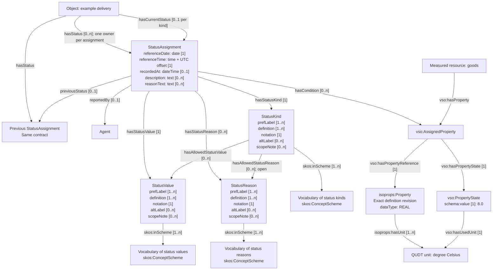

# Status Concept Diagram

**Status:** Implemented; draft release  
**Version:** 0.1.0  
**As of:** 11 November 2026  
**Scope:** `core/status`

## 1. Complete Model

The metadata cardinalities on the three concept classes describe our managed
vocabularies. These classes specialize skos:Concept. Label, definition,
alternative-label and scope-note properties use the skos: prefix. Preferred
labels are unique per language. Conditions reuse existing VSO/ISOProps classes.

## 2. Reading Example

Start at the delivery. Follow hasStatus to a statement, then read its kind
as TemperatureInspection and its value as Failed. The reason may be
TemperatureExceeded. Following hasCondition leads to the goods' temperature
measurement, 8.0 °C, and the referenced ISOProps definition.

The same delivery can independently have a TransportStatus statement with
value Shipped. At most one statement per kind is selected through
hasCurrentStatus, and that statement must be the uniquely latest known one
for the delivery and kind. No subject property is needed.

## 3. History and Boundaries

previousStatus is the optional immediate known predecessor for the same owner
and kind. Explicit predecessor order also applies when timestamps tie.
referenceTime supports at most six fractional second digits. Current
selection is explicit and optional, and must match the uniquely latest known
business-time statement. recordedAt does not affect selection. If latest
timestamps tie, explicit predecessor order must resolve the tie before a
current link can be set. For example, B may be current when both A and B are
at 12:00 and B has previousStatus A; without that known order, omit the link.
Reasons remain open. No correction, interval or workflow class is shown
because these are outside this MVP.
