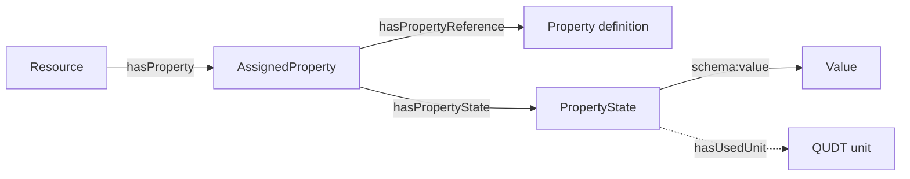

# Conceptual Diagram of the VSO Module

**Status:** Implemented documentation view  
**Version:** 0.1.0  
**As of:** 3 September 2026  
**Scope:** `core/vso`

## 1. Core Model

## 2. Illustrative Example

> The wall references its concrete height assignment. This connects the general “Height” definition to the current value and its unit.

## 3. Further Details

Details are provided in the [Conceptual Model](03_concept-model.md).