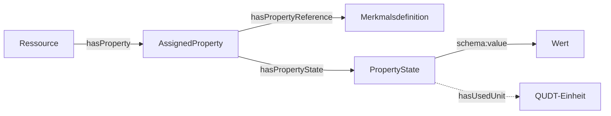

# Konzeptdiagramm des VSO-Moduls

**Status:** Implementierte Dokumentationssicht  
**Version:** 0.1.0  
**Stand:** 3. September 2026  
**Geltungsbereich:** `core/vso`

## 1. Kernmodell

## 2. Lesebeispiel

> Die Wand verweist auf ihre konkrete Höhenzuweisung. Diese verbindet die
> allgemeine Definition „Höhe“ mit dem aktuellen Wert und seiner Einheit.

## 3. Vertiefung

Details stehen im [Konzeptmodell](../concept-model.md).
